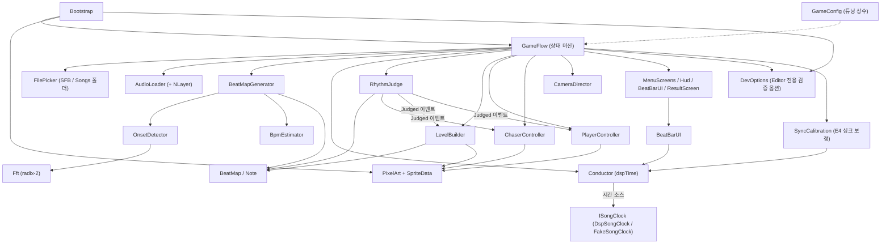

# 구현명세 — 가제: 층간소음 런

이 문서는 AI 코딩 도구(Claude Code, Cursor 등)에 그대로 붙여넣어 Unity 구현을 맡기기 위한 자기완결 명세다. 이 문서에 없는 기능은 만들지 않는다. 심사용 기획서는 `docs/기획서.md`에 따로 있다.

---

## 0. AI에게 주는 작업 규칙

1. **작업 방식 전제**: 이 프로젝트는 AI가 Unity Editor를 CLI(SSH 경유 Unity CLI + Unity Pipeline 패키지)로 직접 조작해 컴파일·자동 플레이 테스트·스크린샷 확인까지 수행한다. 사용자에게 "실행해 보고 알려달라"를 먼저 요청하지 않는다. CLI 사용법, 명령 형식, 검증 규칙, 문제 해결 표는 프로젝트 루트의 `AGENTS.md`를 따른다(이 문서에 반복하지 않는다). 이 문서와 `AGENTS.md`가 충돌하면 CLI 사용법은 `AGENTS.md`, 게임 규칙은 이 문서가 우선한다.
2. **사용자 수준**: 컴퓨터공학 2학년이다. 웹 풀스택 경험은 있지만 게임 개발은 처음이고 Unity도 방금 설치했다. Unity 용어(GameObject, Component, Inspector, Play 버튼 등)가 처음 나오면 한 줄로 설명한다. 사용자에게 에디터 작업을 부탁할 때는 메뉴 경로를 `File > Build Profiles`처럼 정확히 적는다.
3. **에디터 수작업 최소화**: 씬은 템플릿 기본 씬 하나만 쓴다. 모든 GameObject·UI·스프라이트는 코드(`Bootstrap`)가 런타임에 만든다. 프리팹, 애니메이터 컨트롤러, 인스펙터 연결, 머티리얼 에셋은 만들지 않는다. 사용자가 할 일은 2.3절 목록과 아래 5번의 사람 확인뿐이다.
4. **한 번에 작업 하나**: 10절의 T1부터 순서대로 진행한다. 각 작업 안에서 다음 순서를 반복한다.
   1. 코드를 쓰고(마운트된 프로젝트 폴더를 직접 수정) 재컴파일 후 콘솔 오류가 0개일 때까지 고친다.
   2. 해당 작업의 PlayMode 테스트를 만들고 실행해 통과시킨다. 화면이 바뀌는 작업이면 플레이 모드에서 게임 뷰 스크린샷을 찍고 이미지를 직접 열어 이 문서·기획서와 대조한다.
   3. 사용자에게 보고한다: 만든 파일 목록, AI가 확인한 것(테스트 수·통과 수, 스크린샷 경로), 아직 AI가 확인할 수 없는 항목 중 사람이 봐야 할 것(있을 때만).
   4. 사람 확인이 필요한 작업이면 사용자의 답을 받기 전에는 다음 작업으로 넘어가지 않는다. 필요 없으면 바로 다음 작업으로 간다.
5. **사람에게만 요청하는 것**(`AGENTS.md`와 같은 목록): 음악과 판정의 싱크 체감, 재미·난이도 체감 / 네이티브 파일 선택창 동작 1회 확인 / Windows PC에서 빌드 실행 확인 / 최종 결정(고칠 것, 확장 진행 여부). 요청할 때는 무엇을 보고 어떻게 답하면 되는지(예: "비트 표시줄 눈금이 박과 맞으면 '맞음', 앞서면 '빠름', 늦으면 '느림'이라고 답해 주세요") 구체적으로 적는다.
6. **범위 밖 기능 추가 금지**: 11절 체크리스트(F1~F9, E1~E5)에 없는 기능은 만들지 않는다. 더 좋은 아이디어가 있으면 구현하지 말고 제안만 한다. 사용자가 승인하면 그때 진행한다.
7. **수치는 `GameConfig` 한 곳에**: 튜닝 수치는 7.3절 표의 이름 그대로 `GameConfig`에 둔다. 다른 파일에 숫자를 직접 쓰지 않는다. 테스트가 기대값으로 쓰는 숫자도 `GameConfig`를 참조한다.
8. **Unity API**: Unity 6에 실제로 있는 것 중 확신 있는 것만 쓴다. 확신이 없으면 코드를 쓰기 전에 컴파일로 확인하거나, 쓰지 않고 다른 방법을 택한다. 존재하지 않는 API를 지어내지 않는다. CLI 명령 이름도 마찬가지로 `unity command`와 `unity command --query <단어>` 목록으로 확인한 뒤 쓴다(이 문서의 명령 이름은 모두 예시다).
9. **코드 스타일**: C# 하나의 네임스페이스 `NoiseRun`을 쓴다. 정적 가변 상태는 피한다(Enter Play Mode 설정에 따라 값이 남을 수 있음). 스레드에서는 Unity API(GameObject, AudioClip 등)를 호출하지 않는다. 시간에 의존하는 로직은 가짜 시계로 테스트할 수 있게 4.6절 구조를 지킨다.

---

## 1. 게임 요약

- **장르**: 횡스크롤 추격 탈출 리듬게임. 비트 세이버류가 아닌 비브리본(음악 파일로 맵 생성, 장애물을 타이밍에 맞춰 통과)과 크립트 오브 더 네크로댄서(박자에 맞춰서만 행동)를 섞었다.
- **세계관**: 층간소음 민원을 피해 도망치는 뮤지션. 끝까지 잡히지 않고 한 곡을 다 들으면 탈출한다.
- **주인공**: 작고 귀여운 뮤지션. 헤드폰을 쓰고, 구멍 숭숭 난 직사각형 스피커(붐박스)를 어깨에 멨다. 키는 16px로 이웃의 약 1/3이다.
- **추격자**: 아랫집 이웃이 변한 화난 슬라임 괴물. 독성 연두 몸에 빨간 눈, 촉수(위족)로 빗자루를 든다. 키는 46px로 복도 천장(48px) 바로 아래까지 닿으며 주인공의 약 3배다.
- **무대**: 복도식 아파트를 옆에서 본 단면. 복도를 따라 오른쪽으로 달린다(현관문·호수 표지판·복도 난간 반복).
- **그래픽**: 픽셀아트. 모든 스프라이트를 코드 안의 문자 격자로 정의하고 런타임에 만든다.
- **음악**: 사용자가 mp3/wav/ogg 파일을 직접 고른다. 플레이 전에 곡 전체를 분석해 맵을 만든다.
  - 온셋 검출(저음·중음·고음 대역별)
  - BPM 추정
  - 온셋을 반박자 격자로 정렬. 칸당 장애물 최대 1개, 곡 앞 3초는 비움
- **장애물(대역별)**:
  - 저음 → 바닥의 택배 상자 → `Space` 점프
  - 고음 → 천장에 걸린 빨래 → `↓` 슬라이드
  - 중음 → 닫힌 현관 방화문 → `→` 붐박스 볼륨을 확 올린 음파로 문을 날림
- **규칙**:
  - 박자에만 행동할 수 있다. 반박자 격자 판정 범위 밖 입력은 헛박자다(콤보 0 + 추격자 접근).
  - 판정: Perfect ±60ms / Good ±100ms(빠른 곡은 반박자의 40%까지로 줄어듦, 6.2) / 틀린 키 또는 무입력 통과는 Miss. T6 직접 플레이 뒤 사용자 결정으로 ±35/±70ms에서 넓혔다.
  - 화면 하단에 판정 창을 색으로 칠한 타이밍바가 있다(T6 사용자 결정, 처음 기획한 네크로댄서식 박 눈금 대신. 6.5절).
- **추격자**:
  - 곡 진행률에 비례해 빨라진다.
  - Miss·헛박자 때 콤보가 0이 되고 추격자가 한 번에 확 다가온다.
  - 콤보 10·25·50·100…마다 추격자를 뒤로 밀어낸다.
  - 거리가 0이 되면 잡힌다.
- **끝**: 곡이 끝나면 복도 끝 초록 비상구로 뛰어들어 탈출한다. 잡히면 빗자루 정수리 강타 연출 후 GAME OVER가 뜬다. 어느 쪽이든 결과 화면으로 간다.
- **화면 흐름**: 타이틀 → 음악 파일 선택 → 분석 로딩(진행률) → 맵 미리보기(카메라 플라이스루) → 카운트다운 → 플레이(Esc 일시정지) → 탈출 성공 또는 잡힘 연출 → 결과(탈출 성공/잡힘, 점수, Perfect/Good/Miss 수, 최대 콤보) → 재도전 / 다른 곡.
- **구동환경**: Windows(맥에서 개발 후 Windows 빌드로 제출).

---

## 2. 환경·프로젝트 설정

### 2.1 버전과 경로

- Unity **6000.6.9f1**. Windows Build Support (Mono) 모듈은 설치되어 있다.
- 개발 PC: macOS. 제출물: Windows 64-bit 빌드.
- 프로젝트 이름 `beat-runner`(게임 가제는 그대로 "층간소음 런"). 프로젝트 경로: 맥 `~/Dev/beat-runner`. AI는 Docker 컨테이너 안에서 이 폴더가 마운트된 곳을 직접 수정하고, Editor 조작은 `AGENTS.md`의 SSH + Unity CLI 방식으로 한다.
- 이 문서(`구현명세.md`)와 `기획서.md`는 프로젝트의 `docs/`에, `AGENTS.md`는 프로젝트 루트에 둔다.

### 2.2 프로젝트 생성 절차(사용자 작업, 이미 만들어져 있으면 확인만)

1. Unity Hub에서 `New project`를 누른다.
2. Editor 버전으로 6000.6.9f1을 고른다.
3. 템플릿은 **2D (URP)**를 고른다. Hub에서는 "Universal 2D"로 보일 수 있다.
4. Project name은 `beat-runner`, Location은 홈의 `Dev` 폴더로 한다. 결과 경로는 `~/Dev/beat-runner`다.
5. `Create project`를 누르고 Editor가 열린 상태로 둔다(Pipeline 서버가 떠 있어야 AI가 CLI로 조작할 수 있다).
6. 생성된 기본 씬(`Assets/Scenes/SampleScene`)을 그대로 쓴다. 이 씬에 있는 `Main Camera`와 `Global Light 2D`는 지우지 않는다. 2D URP의 기본 스프라이트 머티리얼은 2D 조명을 받으므로, 전역 조명이 없으면 스프라이트가 어둡게 보일 수 있다.
7. 이미 만들어진 프로젝트라면 AI가 `ProjectSettings/ProjectVersion.txt`가 6000.6.9f1인지, `Packages/manifest.json`에 URP(`com.unity.render-pipelines.universal`)가 있는지 읽어 확인한다.

### 2.3 패키지·연결 설정과 사용자 작업

**AI가 하는 환경 설정**(T1 시작 시, 마운트 폴더 파일 수정 + CLI):

| 항목 | 방법 |
|---|---|
| Unity Pipeline 패키지 설치·연결 | 예시: `unity pipeline install`로 `com.unity.pipeline`을 프로젝트에 설치(이미 설치되어 있으면 건너뜀). 연결 확인은 예시: `unity pipeline editors`와 `unity status --until-ready`. 실제 이름은 `unity`와 `unity command` 목록으로 확인한다 |
| Input System | Unity 6 템플릿 기본 포함(`com.unity.inputsystem`). `Packages/manifest.json`에 있는지만 확인 |
| Test Framework | `com.unity.test-framework`가 `Packages/manifest.json`에 있는지 확인(템플릿 기본 포함, 없으면 추가) |
| testables | `Packages/manifest.json` 최상위에 `"testables": ["com.unity.inputsystem"]` 추가. 이래야 Input System의 `InputTestFixture`를 테스트에서 쓸 수 있다 |
| Active Input Handling | `ProjectSettings/ProjectSettings.asset`의 설정이 `Input System Package (New)`(또는 `Both`)인지 확인. 바꾸면 Editor 재시작이 필요하니 사용자에게 알린다 |
| 외부 라이브러리 | 3절 참고. StandaloneFileBrowser 저장소 소스를 받아 `Assets/StandaloneFileBrowser/`에 복사할 수 있으면 AI가 하고, 안 되면 사용자가 `.unitypackage`를 가져온다 |
| 폴더 구조 | `Assets/Scripts/`, `Assets/Resources/Fonts/`, `Assets/Tests/PlayMode/` 생성 |

**사용자가 해야 할 최소 작업**:

| # | 작업 | 시점 |
|---|---|---|
| 1 | 프로젝트 생성(2.2)과 Editor를 열어 둔 상태 유지. `STATUS_PIPELINE_LOAD_PENDING`이면 Unity 창을 한 번 클릭 | T1, 항상 |
| 2 | 한글 도트 폰트 TTF 다운로드 후 `Assets/Resources/Fonts/`에 넣기(2.6). AI가 내려받을 수 있으면 AI가 한다 | T1 |
| 3 | (AI가 소스 복사에 실패했을 때만) StandaloneFileBrowser `.unitypackage` 가져오기: `Assets > Import Package > Custom Package...` (3.1) | T1 |
| 4 | (mp3 로딩 실패 시에만) NLayer 소스 넣기(3.2). AI가 할 수 있으면 AI가 한다 | 필요 시 |
| 5 | `Edit > Project Settings > Player`에서 Company Name·Product Name 입력(AI가 CLI로 못 바꾸면 사용자) | T2 |
| 6 | 네이티브 파일 선택창 동작 확인 1회(10절 T1) | T1 |
| 7 | Windows PC에서 빌드 실행 확인(10절 T2·T9·T15). 빌드 생성 자체는 AI가 CLI로 한다(빌드 명령은 `unity command --query build`로 확인) | T2, T9, T15 |
| 8 | 싱크 체감·재미·난이도 피드백, 최종 결정 | T6, T8, 이후 |

**Bootstrap 자동 시작(권장)**: 씬에 컴포넌트를 붙이지 않는다. `Bootstrap.cs`에 다음 정적 메서드를 두면 Play를 누르거나 빌드를 실행할 때 첫 씬 로드 후 자동 실행된다.

```csharp
[RuntimeInitializeOnLoadMethod(RuntimeInitializeLoadType.AfterSceneLoad)]
static void AutoStart()
{
    if (Object.FindFirstObjectByType<Bootstrap>() != null) return; // 중복 방지
    new GameObject("Bootstrap").AddComponent<Bootstrap>();
}
```

`SampleScene`은 템플릿에서 이미 빌드 씬 목록에 들어 있다. 빌드 때 `File > Build Profiles`의 Scene List에서 체크되어 있는지만 확인한다.

### 2.4 입력

- Unity 6 새 프로젝트에 기본 포함된 **Input System 패키지**를 쓴다.
- `Edit > Project Settings > Player > Other Settings > Active Input Handling`이 `Input System Package (New)`(또는 `Both`)인지 확인한다.
- 키 읽기는 `UnityEngine.InputSystem.Keyboard.current`를 쓴다. 예: `Keyboard.current.spaceKey.wasPressedThisFrame`, `downArrowKey`, `rightArrowKey`, `escapeKey`, `enterKey`.
- InputAction 에셋은 만들지 않는다.
- UI는 전부 키보드로 조작한다. 버튼·마우스 클릭이 없으므로 EventSystem도 필요 없다.

| 키 | 용도 |
|---|---|
| `Space` | 점프(택배 상자) / 미리보기 스킵 / 싱크 보정 중 들리는 박에 맞춰 누르기(E4) |
| `↓` | 슬라이드(빨래) |
| `→` | 음파(방화문) |
| `←`/`→` | 타이틀: 오프셋 미세 조정(E4) |
| `C` | 타이틀: 싱크 보정 시작(E4) |
| `Esc` | 일시정지/재개 / 싱크 보정: 저장하지 않고 타이틀로 |
| `Enter` | 메뉴 확인, 파일 선택창 열기 / 싱크 보정 결과 저장 |
| `↑`/`↓` | 목록 선택(Songs 폴더 대안 화면) |
| `F` | Songs 폴더 목록 화면으로 전환 |
| `R` / `N` | 결과 화면: 재도전 / 다른 곡. `R`은 싱크 보정 결과 화면에서 다시 측정 |
| `Q` | 일시정지 중 곡 선택으로 돌아가기 |

### 2.5 픽셀 표현

- 모든 스프라이트는 **PPU(Pixels Per Unit) 16**으로 만든다. 1 유닛 = 16px.
- 텍스처 설정: `FilterMode.Point`, `TextureWrapMode.Clamp`, 밉맵 없음(`new Texture2D(w, h, TextureFormat.RGBA32, false)`).
- 카메라: `orthographic = true`. 기준 해상도는 480×270(16:9)이고, `orthographicSize = 270 / (2 × 16) = 8.4375`로 둔다.
- 화면이 1920×1080이면 정확히 4배 확대된다. 해상도가 다르면 픽셀이 고르지 않게 보일 수 있다.
  - 필요할 때만 URP의 Pixel Perfect Camera 컴포넌트(`UnityEngine.Rendering.Universal.PixelPerfectCamera`, Assets PPU = 16, Reference Resolution = 480×270)를 코드로 추가한다.
  - 처음에는 넣지 않고, 화면이 뭉개지거나 흔들림이 어색할 때 검토한다.
- **플레이 중 줌(T5 사용자 결정)**: 한 층에 집중하도록 플레이 중에는 `CameraZoom` 0.5를 적용해 `orthographicSize = 4.21875`(월드 기준 240×135px가 보임)로 둔다. 1920×1080에서 정확히 8배, 1280×720에서 5.33배다. 위·아래층은 창문 아래·위 끝만 보인다. 메뉴·갤러리는 기준 크기 8.4375 그대로다.
  - 이 줌에서 주인공 왼쪽으로 보이는 폭은 약 6유닛, 오른쪽은 약 9유닛(장애물이 약 1.1초 전에 나타남)이다. 7.3의 `ChaserStartDistance` 8·`ChaserMaxDistance` 12는 화면 밖이므로 **T7에서 추격자 거리를 이 폭에 맞춰 다시 정한다**.
- 그리기 순서는 `SpriteRenderer.sortingOrder`로 정한다: 배경 0, 복도 1, 장애물 2, 이웃 3, 주인공 4, 이펙트 5.

### 2.6 한글 폰트와 UI

- TextMeshPro 폰트 에셋 생성은 에디터 수작업(Font Asset Creator)이 필요하므로 쓰지 않는다.
- 대신 **legacy `UnityEngine.UI.Text` + 동적 폰트**를 쓴다.
  - TTF 파일을 `Assets/Resources/Fonts/`에 넣는다. Unity가 자동으로 Font로 가져오고 기본 문자 집합은 Dynamic이다.
  - 코드에서 `Resources.Load<Font>("Fonts/<파일명에서 확장자 뺀 이름>")`로 불러 `Text.font`에 넣는다.
- 추천 폰트는 **Galmuri**(한글 도트 폰트, GitHub `quiple/galmuri`)다. 예: `Galmuri11.ttf`.
  - **라이선스는 SIL Open Font License 1.1이다. CC0가 아니다.** 함께 배포할 때 OFL 라이선스 문구를 동봉한다(12절).
- UI 구성:
  - `Canvas`(`RenderMode.ScreenSpaceOverlay`)
  - `CanvasScaler`(`ScaleMode.ScaleWithScreenSize`, referenceResolution 480×270)
  - 그 아래 `Text`/`Image`
- 글자 크기는 폰트 배포처가 권장하는 픽셀 크기의 정수배로 한다.

---

## 3. 외부 라이브러리

### 3.1 StandaloneFileBrowser (gkngkc/UnityStandaloneFileBrowser, MIT)

**용도**: Windows·macOS 공통 네이티브 파일 선택창.

**설치**
1. GitHub 저장소 Releases에서 `.unitypackage`를 받는다.
2. `Assets > Import Package > Custom Package...`로 가져온다.

**사용**
```csharp
using SFB;
var filters = new[] { new ExtensionFilter("Audio", "mp3", "wav", "ogg") };
string[] paths = StandaloneFileBrowser.OpenFilePanel("음악 파일 선택", "", filters, false);
string path = (paths != null && paths.Length > 0 && !string.IsNullOrEmpty(paths[0])) ? paths[0] : null;
```
반환은 동기 호출이고, 취소하면 빈 배열이 온다.

**Unity 6 호환 위험**: 오래 관리되지 않은 플러그인이다. 그래서 첫 작업(T1)에서 바로 동작을 확인한다.
- **macOS(Apple Silicon) 에디터**: 플러그인의 네이티브 번들이 arm64를 지원하지 않으면 `DllNotFoundException` 등이 날 수 있다. 이때는 universal 빌드 번들을 제공하는 포크를 검토하거나, 맥에서는 아래 대안으로 개발한다. Windows 동작은 T2에서 따로 확인한다.
- **Windows**: 플러그인의 Windows 구현이 `System.Windows.Forms`에 의존하는 버전이면 컴파일이나 실행 오류가 날 수 있다. 그러면 `Player > Other Settings > Api Compatibility Level`을 `.NET Framework`로 바꿔 본다.
- 호출은 `try/catch`로 감싼다. 예외가 나면 경고를 Console과 화면에 띄우고 대안 화면으로 넘어간다.

**대안(결정된 폴백)**: `Application.persistentDataPath + "/Songs"` 폴더의 파일 목록에서 고른다.
- 폴더가 없으면 `Directory.CreateDirectory`로 만든다.
- 화면에 폴더의 전체 경로를 보여준다.
  - macOS: `~/Library/Application Support/<Company>/<Product>/Songs`
  - Windows: `%USERPROFILE%\AppData\LocalLow\<Company>\<Product>\Songs`
- `Directory.GetFiles`로 `.mp3/.wav/.ogg`만 걸러 목록을 보여준다. `↑/↓`로 고르고 `Enter`로 정한다.
- 이 대안 화면은 SFB 성공 여부와 관계없이 `F` 키로 항상 열 수 있게 둔다. 두 경로 모두 결과는 "파일 경로 문자열"이다.

### 3.2 오디오 로딩과 NLayer (naudio/NLayer, MIT)

**기본 경로**: `UnityWebRequestMultimedia.GetAudioClip(uri, audioType)`
- `uri`: `"file://" + 경로`. 공백·한글이 있는 경로는 `new System.Uri(path).AbsoluteUri`로 만드는 편이 안전하다.
- `audioType`: 확장자별로 `.mp3` → `AudioType.MPEG`, `.wav` → `AudioType.WAV`, `.ogg` → `AudioType.OGGVORBIS`.
- 요청을 보내기 전에 `var dh = (DownloadHandlerAudioClip)req.downloadHandler; dh.streamAudio = false; dh.compressed = false;`로 설정한다. 그래야 메모리에 PCM으로 풀린 클립이 되어 `AudioClip.GetData`가 동작한다.
- 결과는 `DownloadHandlerAudioClip.GetContent(req)`로 받는다. `req.result != UnityWebRequest.Result.Success`, 클립이 null, `clip.length == 0` 중 하나라도 해당하면 실패로 본다.

**mp3 실패 시 폴백(NLayer)**: mp3 런타임 로딩은 플랫폼·버전에 따라 실패할 수 있다. 실패하면 NLayer로 직접 디코딩한다.
- **설치**: 다음 중 하나를 고른다.
  - GitHub `naudio/NLayer` 소스의 `NLayer` 프로젝트 폴더(.cs 파일들)를 `Assets/Plugins/NLayer/`에 복사한다.
  - NuGet 패키지 NLayer의 `netstandard` DLL을 `Assets/Plugins/`에 넣는다.
- **사용(개념)**:
  1. `new NLayer.MpegFile(path)`로 연다.
  2. `SampleRate`, `Channels`를 읽는다.
  3. `ReadSamples(float[] buffer, int index, int count)`를 0이 나올 때까지 반복해 인터리브 float 샘플을 모은다.
  4. `AudioClip.Create(name, 총샘플수 / channels, channels, sampleRate, false)` 다음 `clip.SetData(samples, 0)`을 호출한다.
- NLayer 디코딩은 시간이 걸릴 수 있다. 백그라운드 `Task`에서 PCM을 만들고 `AudioClip.Create/SetData`만 메인 스레드에서 한다.
- wav/ogg가 실패하면 폴백 없이 화면에 오류("파일을 읽을 수 없습니다: <이유>")를 띄우고 파일 선택으로 돌아간다.

---

## 4. 아키텍처

### 4.1 원칙

- 단일 씬. `Bootstrap`이 카메라 설정, Canvas, 폰트, 모든 시스템 오브젝트를 만들고 `GameFlow`에 넘긴다.
- 물리 엔진(Rigidbody2D, Collider)은 쓰지 않는다. 장애물 통과 여부는 오직 `RhythmJudge`의 판정으로 정하고, 화면 연출은 판정 결과를 따라간다.
- 좌표: 월드 x = 곡 시간(초) × `ScrollSpeed`. 바닥 y = 0. 주인공은 매 프레임 `x = SongTime × ScrollSpeed`로 이동하고, 카메라가 따라간다.
- 분석은 백그라운드 `Task`, Unity API 호출은 메인 스레드에서만.

### 4.2 폴더와 스크립트 목록

`Assets/Scripts/` 아래에 둔다(네임스페이스 `NoiseRun`). 이 폴더 전체를 어셈블리 정의 `NoiseRun.Runtime`(asmdef)로 묶는다(4.6절). 테스트 코드는 `Assets/Tests/PlayMode/`에 따로 둔다(4.6절).

| 파일 | 책임 | 주요 public API |
|---|---|---|
| `Core/Bootstrap.cs` | 자동 시작, 카메라(`Camera.main`이 있으면 재사용, 없으면 생성)·Canvas·폰트·시스템 생성, 의존성 연결. 테스트가 시계를 바꿔 다시 만들 수 있어야 함 | `static void AutoStart()` (2.3), `static Bootstrap Instance { get; }`, `GameFlow Flow { get; }`, `static Bootstrap Restart(ISongClock clockOrNull)` (기존 Bootstrap 오브젝트를 파괴하고 새로 만듦. 테스트용), `LevelBuilder Level`·`PlayerController Player`·`CameraDirector CameraDirector { get; }`(T5 추가. 모두 Bootstrap 오브젝트 아래에 만들어 Restart 때 함께 제거. 씬 카메라에는 컴포넌트를 붙이지 않음), `Hud Hud`·`BeatBarUI BeatBar { get; }`(T6 추가. Canvas 아래, Playing에서만 보임. `GameFlow.Judge`는 GameFlow가 만든 `RhythmJudge`) |
| `Core/GameConfig.cs` | 모든 튜닝 상수(7.3절 표) | `public static class GameConfig { public const float ScrollSpeed = 8f; ... }` |
| `Core/DevOptions.cs` | 개발·검증용 옵션. `#if UNITY_EDITOR`에서만 프로젝트의 `Temp/noiserun_dev.txt`(한 줄에 `키=값`)를 읽는다. 빌드에서는 파일을 읽지 않고 모두 기본값(false/null)이다. `FreezeAt`이 있으면 `Bootstrap`이 `FakeSongClock`을 쓴다 | `static string AutoFile { get; }`, `static bool AutoPlay`, `static bool NoCatch`, `static bool Gallery`, `static string StartAt { get; }`(`title`, `preview`, `playing`, `debug`), `static double? FreezeAt`(곡 시간 고정, 장면 캡처용), `static float TimeScale`(Preview·Caught·Escaped 연출을 느리게 보는 용도, 기본 1), `static string ForceEnd { get; }`(`caught`/`escaped`, 연출 즉시 시작), `static bool Load()` |
| `Core/GameFlow.cs` | 상태 머신, 화면 전환, 입력 분배. 시간 의존 로직은 `Step`으로 모아 테스트가 직접 호출 | `enum GameState { Title, Calibrating, SelectFile, Analyzing, Preview, Countdown, Playing, Paused, Caught, Escaped, Result }`, `GameState State { get; }`, `event Action<GameState, GameState> StateChanged`, `void ChangeState(GameState next)`, `void StartFromFile(string path)`(디버그용 진입점: 파일 선택창을 건너뛰고 로딩·분석으로 감), `void StartFromClip(AudioClip clip, string songName)`(테스트용: 디코딩도 건너뜀), `void Step(double songTime, float dt)`(Playing 상태의 판정·추격자·종료 조건 갱신. `Update`는 `Conductor.SongTime`과 `Time.deltaTime`으로 호출), `RhythmJudge Judge`, `ChaserController Chaser`, `BeatMap Map { get; }`, `string LastError { get; }`(T3 추가: SelectFile에 띄울 직전 오류, 테스트가 읽음), `Difficulty CurrentDifficulty { get; set; }`(T5 추가: 5.7절. 기본 `DefaultDifficulty`, 실행 중에만 유지하고 저장하지 않음), `bool AutoPlay { get; set; }`(T5 추가: Bootstrap이 `DevOptions.AutoPlay`로 정하고 테스트가 직접 바꿈. 노트 시각을 지날 때마다 정답 동작을 한 번씩 실행, 프레임이 건너뛰어도 지난 노트 모두 실행. 조합 노트는 Box·Laundry·Door 순 첫 플래그), `int AutoActionsFired { get; }`(T5 리뷰 M4: Playing 진입 때 0, autoPlay 동작 1회마다 +1. 테스트가 읽음), `bool DebugPreview { get; set; }`(T5 추가: `startAt=debug`면 Bootstrap이 true로 둠. true면 분석 뒤 T3 디버그 화면(Preview)으로 감). 클립 소유권은 두 진입점 모두 GameFlow(해제 시 Destroy). **T5 임시(T8에서 교체)**: 분석 성공 → `LevelBuilder.Build`, 주인공 배치, 카메라 추적, `ScheduleStart(CountdownStepSec × CountdownSteps)`(카운트다운 숫자 없음) → 바로 Playing. Playing에서 `Esc` → 정지·레벨 정리(`PlayerController.ResetPose` 포함)·SelectFile. 곡이 끝나면 주인공이 `ExitX`까지 달려가 멈춘 채 대기 |
| `Core/SaveData.cs` | PlayerPrefs 래퍼(E4 오프셋, E5 최고 기록) | `static float AudioOffsetSec { get; set; }`, `static int GetBest(string songKey)`, `static bool TrySetBest(string songKey, int score)`. `songKey`에는 난이도가 들어간다(10절 T12) |
| `Audio/FilePicker.cs` | SFB 호출, Songs 폴더 대안 | `static string OpenDialog()` (취소·실패 시 null), `static string SongsFolder { get; }`, `static string[] ListSongs()` |
| `Audio/AudioLoader.cs` | 파일 → AudioClip, mp3 NLayer 폴백, PCM 추출 | `static IEnumerator Load(string path, Action<AudioClip> onLoaded, Action<string> onError)`, `static AudioType GuessAudioType(string path)`, `static float[] ReadInterleaved(AudioClip clip)` (메인 스레드) |
| `Audio/Conductor.cs` | 곡 시간 제공, 예약 재생, 일시정지. 시간 소스는 `ISongClock`로 분리(기본 `DspSongClock`, 테스트는 `FakeSongClock`) | `ISongClock Clock { get; set; }`, `double SongTime => Clock.SongTime`, `double SongLength { get; }`, `void Load(AudioClip clip)`, `void ScheduleStart(double delaySec)`, `void Pause()`, `void Resume()`, `void Stop()`, `IEnumerator FadeOutAndStop(float sec)`, `double? FrozenSongTime { get; set; }`(T3 추가: `DevOptions.FreezeAt`용. 시계가 `FakeSongClock`이면 `ScheduleStart` 뒤에도 곡 시간을 이 값으로 유지) |
| `Audio/ISongClock.cs` | 곡 시간 시계 인터페이스와 구현 | `interface ISongClock { double SongTime { get; } void Start(double delaySec); void Pause(); void Resume(); }`, `sealed class DspSongClock : ISongClock`(6.4절 계산), `sealed class FakeSongClock : ISongClock { public double Time; }`(테스트가 `Time`을 직접 설정. `Start(delay)`는 `Time = -delay`) |
| `Audio/SyncCalibration.cs` (E4) | 메트로놈 클립 합성, 캘리브레이션 입력 기록, 오프셋 계산 | `static AudioClip MakeMetronomeClip(int sampleRate)`(약 800Hz 사인 + 지수 감쇠 약 40ms 클릭, 테스트 음원 `ClickTrack`과 같은 방식), `static double ClickTime(int index)`(= `CalibrationLeadInSec + index × 60 / CalibrationBpm`), `static CalibrationResult Compute(IReadOnlyList<double> pressTimes)`(순수 함수, Unity API 없음, 테스트가 직접 호출) |
| `Audio/SfxPlayer.cs` (E3) | 코드로 합성한 효과음 재생 | `void Play(SfxId id)` |
| `Analysis/Fft.cs` | radix-2 반복 FFT 직접 구현 | `Fft(int n)`, `void Forward(float[] re, float[] im)`, `static float[] Hann(int n)` |
| `Analysis/OnsetDetector.cs` | 모노 믹스다운, 대역별 스펙트럴 플럭스(원음 + HPSS 타악기, 곡 단위 자동 전환), 적응 임계값 피크 | `static float[] ToMono(float[] interleaved, int channels)`, `static OnsetResult Detect(float[] mono, int sampleRate, AnalysisProgress progress)` |
| `Analysis/BpmEstimator.cs` | 자기상관 BPM + 위상 | `static BpmResult Estimate(float[] strengthCurve, double hopSec, double songLength)` |
| `Analysis/BeatMapGenerator.cs` | 분석 전체 조립, 반박자 정렬, 장애물 종류 결정, 난이도별 밀도(5.7) | `static Task<AnalysisOutput> AnalyzeDetailedAsync(float[] interleaved, int channels, int sampleRate, double songLength, AnalysisProgress progress, Difficulty difficulty)`(T3 추가: 맵·온셋·BPM 결과·소요 시간. 분석 불가는 `AnalysisFailedException`으로 Task 실패. `difficulty` 인자는 T5 추가), `static Task<BeatMap> AnalyzeAsync(...)`(같은 인자, 위 결과의 맵만), `static BeatMap Generate(OnsetResult o, BpmResult b, double songLength, Difficulty difficulty)`(`difficulty` 인자는 T5 추가. 재분석 없이 난이도만 바꿀 때도 이것만 다시 부른다), `NoteCandidate { slotIndex, score, energy, kind, OnBeat }`·`static List<NoteCandidate> Candidates(OnsetResult, BpmResult, double songLength)`(5.6 칸 창 A·에너지 선별 B를 거친 후보)·`static double NoteRatio(Difficulty)`·`static int KeepCount(int candidates, Difficulty)`(T5 추가: 5.6 후보·5.7 비율. 반올림은 `MidpointRounding.AwayFromZero`. 테스트가 후보 점수·에너지를 읽음) |
| `Analysis/BeatMap.cs` | 데이터 정의 | 아래 4.3 |
| `Gameplay/RhythmJudge.cs` | 입력·자동 Miss 판정, 점수·콤보. T6: MonoBehaviour가 아닌 일반 클래스이고 GameFlow가 만든다 | `event Action<JudgeEvent> Judged`(점수·콤보·`note.judged`를 먼저 바꾼 뒤 발생), `void Reset(BeatMap map)`(null이면 비활성), `void OnInput(ActionType a, double songTime)`(판정 전에 `Tick(songTime)`을 먼저 부름), `void Tick(double songTime)`, `int Score, Combo, MaxCombo, PerfectCount, GoodCount, MissCount { get; }`, `static ActionType RequiredAction(ObstacleKind kind)`(T6: Box→Jump, Laundry→Slide, 그 밖→Wave), `static int ScoreFor(Judgement j, int comboAfter)`(T6), `static double GoodWindowFor(BeatMap m)`·`static double PerfectWindowFor(BeatMap m)`(T6: 곡의 판정 창, 6.2). 판정마다 Console에 `[Judge] <판정> Δ=<ms>ms note=<번호> action=<동작>`. `JudgeEvent.noteIndex`는 OffBeat·EmptyBeat면 −1, 무입력 Miss의 `action`은 정답 동작 |
| `Gameplay/PlayerController.cs` | 주인공 위치·동작(달리기·점프·슬라이드·음파·맞음·휘청) | `static PlayerController Create(Transform parent)`(T5), `void SetX(float x)`, `void DoAction(ActionType a, float duration)`, `void PlayHit()`(T6: `PlayerHit`을 `HitFlashSec` 동안), `void PlayStumble()`(T6: `PlayerStumble`을 `StumbleSec` 동안), `enum Reaction { None, Hit, Stumble }`·`Reaction CurrentReaction { get; }`(T6, 테스트가 읽음. 반응과 동작은 서로를 끊는다), `void SetRunning(bool running)`, `void Face(bool right)`, `ActionType? CurrentAction { get; }`(T5: 동작 중이 아니면 null, 테스트가 읽음), `void Advance(float dt)`(T5: 동작·반응 타이머 진행. Update가 `Time.deltaTime`으로 부르고 테스트는 직접 호출), `static float ActionDuration(double halfBeatSec)`(T5: `min(ActionMaxSec, 반박자 × ActionBeatFactor)`), `void ResetPose()`(T5 리뷰 L5: 동작·반응 취소·음파 숨김·바닥 y·대기 프레임. 레벨 정리 때 GameFlow가 부름). 점프 높이 곡선 `JumpHeight × sin(π × u^JumpRiseExponent)` |
| `Gameplay/ChaserController.cs` | 추격자 거리 계산·표시·휘두르기 | `float Distance { get; }`, `event Action Caught`, `void ResetChase()`, `void Tick(double songTime, double songLength, float dt, float playerX)`, `void Approach(float amount)`, `void OnComboChanged(int combo)`, `IEnumerator PlaySwing()` |
| `Gameplay/LevelBuilder.cs` | 복도 타일, 장애물, 비상구 생성과 판정별 반응 | `static LevelBuilder Create(Transform parent)`(T5), `void Build(BeatMap map)`, `void Clear()`, `float TimeToX(double t)`, `float ExitX { get; }`, `Transform ObstacleFor(int noteIndex)`·`Transform Exit { get; }`(T5: 테스트용), `void OnJudged(JudgeEvent e)`(T6: Perfect/Good + 방화문이면 날아감, 6.3), `void Advance(float dt)`(T6: 날아가는 문 진행. Update가 부르고 테스트는 직접 호출), `IEnumerator OpenExitDoor()`. T5: 격자당 Sprite 1개를 공유하고 타일 줄마다 `SpriteRenderer` 1개(Tiled), `Clear`가 만든 텍스처·스프라이트를 Destroy. 복도는 `-(LeadInDistanceUnits + LevelMarginUnits)`부터 `ExitX + LevelMarginUnits`까지. 조합 노트(E1)는 첫 플래그 그림만 놓음 |
| `View/CameraDirector.cs` | 추적, 플라이스루, 흔들림 | `static CameraDirector Create(Camera cam, Transform parent)`(T5: 컴포넌트는 parent 아래 새 오브젝트에 두고 카메라 Transform만 움직임), `void Follow(Transform target)`(null이면 멈춤. 대상을 주면 `orthographicSize`를 `PlayCameraOrthoSize`로 바꾸고(사용자 결정 줌 0.5), LateUpdate에서 주인공을 화면 폭 `PlayerViewportX`에 두고 y는 `CameraY`, 주인공과의 오프셋만 1/PPU 격자에 맞춤), `IEnumerator PreviewFlythrough(float startX, float endX)`, `void RequestSkip()`, `void Shake(float amplitude, float duration)` |
| `View/BeatBarUI.cs` | 하단 타이밍바(6.5, T6 사용자 결정) | `static BeatBarUI Create(Transform canvasRoot)`(처음엔 숨김), `void Bind(BeatMap map, Conductor conductor)`(null이면 해제), `void SetVisible(bool v)`, `void Refresh(double songTime)`(Update가 `Conductor.SongTime`으로 부르고 테스트는 직접 호출), `int TargetNoteIndex { get; }`(첫 미판정 노트, 없으면 −1), `float CurrentLineOffsetPx { get; }`, `static float LineOffsetPx(double timeToNote)`, `static float ZoneHalfWidthPx(double windowSec)`, `static float IconScale(BeatMap map, double songTime)` |
| `View/Hud.cs` | 점수·콤보(오른쪽 위)·판정 문구(주인공 머리 위) | `static Hud Create(Transform canvasRoot)`(처음엔 숨김), `void SetScore(int s)`, `void SetCombo(int c)`(0이면 콤보 줄 숨김), `void ShowJudgement(Judgement j)`(EmptyBeat는 표시 없음), `void Follow(Transform target, Camera cam)`, `void SetVisible(bool v)`, `void Clear()`, `void Advance(float dt)`, 테스트용 `string ScoreLabel`·`ComboLabel`·`JudgementLabel` |
| `View/MenuScreens.cs` | 타이틀(현재 오프셋 표시 포함), 싱크 보정, 파일 선택, Songs 목록, 불러오기, 분석 진행률, 카운트다운, 일시정지, GAME OVER/탈출 문구. Bootstrap이 `new MenuScreens(canvas)`로 만들어 GameFlow에 넘김 | `void ShowTitle()`, `void ShowCalibration(int done, int total, string message)`, `void ShowSelect(string message)`, `void ShowSongList(string folder, string[] files, int selected, string message = null)`(T3: 폴더 경로·오류 문구 인자 추가), `string SongName { get; set; }`·`void ShowLoading()`(T3 추가: 불러오기·분석 화면의 곡 이름), `void ShowAnalyzing(float progress, string stage)`, `void ShowCountdown(string text)`, `void ShowPause(bool on)`, `void ShowBanner(string text)`, `void HideAll()`, `Difficulty Difficulty { get; set; }`(T5 추가, 사용자 결정: `SongName`과 같은 속성 방식. 파일 선택·Songs 목록 화면에 "난이도: 쉬움/보통/어려움   ←/→: 난이도"를 표시하고, 바꾸면 그 줄만 갱신) |
| `View/ResultScreen.cs` | 결과 화면 | `void Show(ResultData d)`, `void Hide()`. T8: 난이도 표시와 "←/→: 난이도, R: 다시" 안내 |
| `View/UiFactory.cs` | Canvas 하위 Text/Image 생성 헬퍼 | `static Text MakeText(Transform parent, string s, int size, TextAnchor anchor, Vector2 anchoredPos)`, `static Image MakeImage(Transform parent, Sprite sprite, Vector2 size, Vector2 anchoredPos)` |
| `View/AnalysisDebugView.cs` | T3 디버그 시각화(온셋·박 위치) | `static AnalysisDebugView Create(Transform canvasRoot)`, `void Show(AnalysisOutput result, Conductor c)`(T3: confidence·소요 시간이 `BeatMap`에 없어 `AnalysisOutput`을 받음), `void Hide()` |
| `Art/PixelArt.cs` | 문자 격자 → Sprite 팩토리, 팔레트 | `static Sprite Make(string[] rows, Vector2 pivot)`, `static Sprite[] MakeFrames(string[][] frames, Vector2 pivot)`, `static Sprite WhitePixel { get; }` |
| `Art/SpriteData.cs` | 모든 문자 격자 데이터 | `static readonly string[] Box`, `static readonly string[][] PlayerRun` 등 |
| `Art/SpriteAnimator.cs` | 프레임 순환 재생 | `void Play(Sprite[] frames, float fps, bool loop)`, `void SetFrame(Sprite s)`, `void Advance(float dt)`(Update가 `Time.deltaTime`으로 부름. 테스트는 직접 호출) |
| `View/SpriteGallery.cs` | T4 스프라이트 갤러리. Editor 전용(`#if UNITY_EDITOR`), `gallery=true` 개발 옵션(`DevOptions.Gallery`)일 때 모든 스프라이트를 한 화면에 나열 | `static SpriteGallery Create(Transform parent)` |

### 4.3 데이터 정의(`BeatMap.cs`)

```csharp
public enum Band { Low, Mid, High }
[Flags] public enum ObstacleKind { None = 0, Box = 1, Laundry = 2, Door = 4 } // 조합(E1)은 플래그 OR
public enum ActionType { Jump, Slide, Wave }                    // Space, ↓, →
public enum Judgement { Perfect, Good, Miss, OffBeat, EmptyBeat } // OffBeat = 헛박자, EmptyBeat = 격자 안·장애물 없음
public enum Difficulty { Easy, Normal, Hard }                   // T5 추가: 쉬움·보통·어려움(5.7절)

public struct Onset { public double time; public Band band; public float strength; } // strength = 플럭스 / 임계값(≥1)

public sealed class Note {
    public double time;        // 정렬된 칸의 시각(초)
    public ObstacleKind kind;  // Box/Laundry/Door, E1이면 조합
    public int slotIndex;      // 반박자 칸 인덱스
    public bool judged;
    public ActionType pendingFirst; public bool hasPending; // E1 조합 입력 중간 상태
}

public sealed class BeatMap {
    public float bpm;
    public double firstBeatTime;   // 첫 정박 시각(초), 0 ≤ firstBeatTime < 박 길이
    public double HalfBeatSec => 30.0 / bpm;
    public double songLength;
    public bool bpmFallbackUsed;
    public Difficulty difficulty;  // T5 추가: 이 맵을 만든 난이도
    public List<Note> notes;       // 시간순
    public double SlotTime(int idx) => firstBeatTime + idx * HalfBeatSec;
    public int NearestSlot(double t) => (int)Math.Round((t - firstBeatTime) / HalfBeatSec);
}

public sealed class OnsetResult { public float[][] bandFlux; public float[][] bandThreshold; public float[] strengthCurve; public List<Onset> onsets; public double hopSec; public bool percussive; public float percussiveRatio; } // bandFlux는 쓴 쪽(타악기 또는 원음) 플럭스. percussive·percussiveRatio는 HPSS 추가(5.3)
public sealed class BpmResult { public float bpm; public double firstBeatTime; public float confidence; public bool fallback; }
public sealed class AnalysisProgress { public volatile float value; public volatile string stage; } // 워커가 쓰고 메인이 읽음
public sealed class AnalysisOutput { public BeatMap map; public OnsetResult onsets; public BpmResult bpm; public double elapsedSec; } // T3 추가: 분석 전체 결과(디버그 화면용)
public sealed class AnalysisFailedException : Exception { } // T3 추가: 분석 불가. Message를 화면에 그대로 띄움
public readonly struct JudgeEvent { public readonly Judgement judgement; public readonly int noteIndex; public readonly double delta; public readonly ActionType action; /* 생성자 생략 */ }
public sealed class ResultData { public bool escaped; public Difficulty difficulty; public int score, perfect, good, miss, maxCombo, best; } // difficulty는 T5 추가
public sealed class CalibrationResult { public bool ok; public double offsetSec; public double medianSec; public double madSec; public int used; public string failReason; } // E4 싱크 보정 결과
```

### 4.4 의존 관계



### 4.5 상태 전이(GameFlow)

| 현재 | 조건 | 다음 | 진입 시 할 일 |
|---|---|---|---|
| Title | `Enter` | SelectFile | 타이틀·조작 안내와 현재 오프셋(ms, 부호 포함) 표시. E4가 구현되면 `←/→`로 오프셋을 `AudioOffsetStepSec` 단위로 조정 |
| Title | `C` (E4) | Calibrating | 기존 오프셋을 적용하지 않은 시계로 메트로놈 클립 예약 재생(`Conductor.ScheduleStart`), `ShowCalibration(0, CalibrationClicks, "들리는 소리에 맞춰 Space를 누르세요")`. 박을 보여 주는 시각 신호(깜빡임, 비트 표시줄)는 띄우지 않음 |
| Calibrating | `Space` | Calibrating | `SongTime`(오프셋 0 기준) 기록, 진행 수(예: 7/16) 갱신 |
| Calibrating | 마지막 클릭 끝 | Calibrating | `SyncCalibration.Compute`로 결과 계산·표시(성공: "측정값 +42ms → +0.04초", 실패: 실패 이유와 "R로 다시") |
| Calibrating | 결과 표시 중 `Enter`(성공일 때만) | Title | `SaveData.AudioOffsetSec`에 저장. 실패면 `Enter`를 무시 |
| Calibrating | 결과 표시 중 `R` | Calibrating | 기록을 비우고 처음부터 다시 측정 |
| Calibrating | `Esc` | Title | `Conductor.Stop()`, 저장하지 않음 |
| SelectFile | `Enter` → 파일 선택창에서 경로 받음 / `F` → 목록에서 `Enter` | Analyzing | 안내 문구, 직전 오류 메시지, 현재 난이도 표시. 분석에는 `CurrentDifficulty`를 넘긴다 |
| SelectFile | `←`/`→` (T5) | SelectFile | `CurrentDifficulty`를 한 단계 낮춤/높임(쉬움·어려움에서 멈춤, 순환하지 않음). 기본 화면과 Songs 목록 모두에서 받는다 |
| SelectFile | 취소 | SelectFile | 그대로 유지 |
| Analyzing | 로딩·분석 성공 | Preview | `LevelBuilder.Build`, 주인공 x=0 배치 |
| Analyzing | 실패(로딩 오류, 온셋 부족, 곡 너무 짧음) | SelectFile | 오류 문구 전달 |
| Preview | 플라이스루 끝 또는 `Space`/`Enter` 스킵 | Countdown | `Conductor.ScheduleStart(CountdownStepSec × 3)` |
| Countdown | `SongTime ≥ 0` | Playing | 3·2·1은 `SongTime`이 음수인 동안 표시, 0에서 "GO" |
| Playing | `Esc` 또는 창 포커스 잃음(`OnApplicationFocus(false)`) | Paused | `Conductor.Pause()`, `Time.timeScale = 0` |
| Paused | `Esc` | Playing | `Conductor.Resume()`, `Time.timeScale = 1` |
| Paused | `Q` | SelectFile | `Conductor.Stop()`, 레벨 정리 |
| Playing | `ChaserController.Caught` | Caught | 8.3 연출 |
| Playing | `SongTime ≥ SongLength` | Escaped | 8.2 연출 |
| Caught / Escaped | 연출 끝 | Result | `ResultScreen.Show` |
| Result | `←`/`→` (T8) | Result | `CurrentDifficulty` 변경, 결과 화면의 난이도 표시만 갱신 |
| Result | `R` | Preview | 같은 클립 재사용(재분석 없음). `CurrentDifficulty`가 `Map.difficulty`와 다르면 저장해 둔 `OnsetResult`·`BpmResult`로 `BeatMapGenerator.Generate`만 다시 불러 맵을 바꾼다. 레벨·판정·추격자 초기화 |
| Result | `N` | SelectFile | 클립 해제 |

카운트다운 중 일시정지는 받지 않는다. 그래서 예약 재생 중 정지 처리가 필요 없다.

### 4.6 테스트 가능한 구조와 PlayMode 테스트 어셈블리

**어셈블리 구성**

| 파일 | 내용 |
|---|---|
| `Assets/Scripts/NoiseRun.Runtime.asmdef` | 게임 코드 전체. `rootNamespace`는 `NoiseRun`. 참조: `Unity.InputSystem`, `UnityEngine.UI`, 그리고 아래 외부 라이브러리 asmdef |
| `Assets/StandaloneFileBrowser/StandaloneFileBrowser.asmdef` | 라이브러리 소스를 받아 넣은 뒤 AI가 추가. 별도 asmdef가 없으면 기본 어셈블리(Assembly-CSharp)에 들어가 `NoiseRun.Runtime`이 참조할 수 없다 |
| `Assets/Plugins/NLayer/NLayer.asmdef` (mp3 폴백을 쓸 때만) | 위와 같은 이유 |
| `Assets/Tests/PlayMode/NoiseRun.Tests.PlayMode.asmdef` | 테스트 전용. 참조: `NoiseRun.Runtime`, `UnityEngine.TestRunner`, `UnityEditor.TestRunner`, `Unity.InputSystem`, `Unity.InputSystem.TestFramework`. `overrideReferences: true` + `precompiledReferences: ["nunit.framework.dll"]`, `defineConstraints: ["UNITY_INCLUDE_TESTS"]`. 어셈블리 이름이나 설정이 틀리면 재컴파일 오류로 알려주므로 그 메시지로 고친다 |

테스트 어셈블리는 기본 어셈블리를 참조할 수 없으므로, 게임 코드를 asmdef로 묶는 것이 PlayMode 테스트를 쓰는 전제 조건이다. T1에서 만든다.

**시계 분리**

- 곡 시간에 의존하는 모든 코드(`RhythmJudge`, `ChaserController`, `BeatBarUI`, `GameFlow`)는 `Conductor.SongTime`만 읽고, `Conductor`는 `ISongClock`만 안다. 테스트는 `FakeSongClock.Time`을 올려 시간을 직접 진행한다. 실제 오디오 재생과 프레임 시간에 의존하지 않으므로 결과가 결정적이다.
- `GameFlow.Step(songTime, dt)`가 판정 `Tick`, 추격자 `Tick`, 종료 조건(잡힘·탈출)을 모두 처리한다. 테스트는 시계를 올리고 `Step`을 호출해 한 판을 순식간에 돌린다.
- 입력은 `Keyboard.current`를 읽는 `GameFlow.Update` 안에서만 받는다. 테스트는 `InputTestFixture`로 가상 키보드를 만들어 `Press(keyboard.spaceKey)` 등으로 눌러 이 경로를 통과시키고, 판정 로직만 따로 보려면 `RhythmJudge.OnInput`을 직접 호출한다.

**자동 시작과 테스트의 관계**: `Bootstrap.AutoStart`는 PlayMode 테스트가 시작될 때도 실행된다. 그래서 모든 테스트의 `SetUp`은 `Bootstrap.Restart(new FakeSongClock())`로 시작한다(기존 오브젝트를 파괴하고 가짜 시계로 새로 만듦). `Bootstrap`은 타이틀 화면만 띄우고 파일 선택창을 자동으로 열지 않아야 한다.

**디버그용 진입점**(네이티브 파일 선택창은 CLI로 조작할 수 없으므로)

- `GameFlow.StartFromFile(path)`는 파일 선택창과 Songs 목록을 건너뛰고 로딩 → 분석 → Preview 흐름을 시작한다. 실제 `AudioLoader`를 그대로 쓰므로 로더 경로까지 검증된다.
- `GameFlow.StartFromClip(clip, name)`은 테스트가 코드로 만든 `AudioClip`을 넘긴다. 로딩을 건너뛰고 분석부터 시작한다.
- 플레이 모드를 CLI로 시작해 스크린샷을 찍을 때는 `Temp/noiserun_dev.txt`(Editor 전용, 4.2절 `DevOptions`)를 쓴다. 한 줄에 `키=값`. 예:

```
file=/Users/<이름>/Dev/beat-runner/Temp/test120.wav
startAt=playing
autoPlay=true
noCatch=true
```

  `startAt`은 분석이 끝난 뒤 어디까지 자동으로 진행할지(`title`, `preview`, `playing`, `debug`=T3 분석 디버그 화면)다. 그 밖의 키는 `freezeAt=<초>`(`FakeSongClock`으로 곡 시간을 고정해 그 순간의 장면을 캡처), `timeScale=<배수>`(연출 구간을 느리게 보기. `Playing` 중 `dspTime`에는 영향이 없으므로 `Playing` 장면은 `freezeAt`을 쓴다), `forceEnd=caught|escaped`(해당 연출을 즉시 시작), `gallery=true`(T4 스프라이트 갤러리)다. 빌드에서는 이 파일을 읽지 않는다. 키 이름과 허용 값은 `DevOptions`가 한곳에서 정하고, 모르는 키는 Console 경고로 알린다.

**테스트 음원 생성**(`Assets/Tests/PlayMode/TestSupport/TestAudio.cs`, 저작권 문제 없음)

| 함수 | 설명 |
|---|---|
| `float[] ClickTrack(int sampleRate, double seconds, float bpm, double firstBeatSec, Band onBeat, Band? offBeat)` | 박마다 짧은 클릭(지수 감쇠 약 40ms)을 넣은 모노 신호. `onBeat`는 정박, `offBeat`는 반박(없으면 생략)의 대역. 대역별 소리는 저음 약 60Hz 사인, 중음 약 800Hz 사인, 고음 약 5000Hz 사인 |
| `AudioClip ToClip(float[] mono, int sampleRate)` | `AudioClip.Create` + `SetData`(테스트의 `StartFromClip`용) |
| `void WriteWav(string path, float[] mono, int sampleRate)` | 16비트 PCM wav 파일 쓰기(로더·`StartFromFile` 경로 검증용, `Temp/` 아래에 씀) |

**테스트 목록**(PlayMode, 테스트 이름은 예시)

| 파일 | 검증 항목 | 관련 ID |
|---|---|---|
| `FftTests.cs` | 1000Hz 사인파 최대 bin = 23, Parseval 대략 일치 | F2 |
| `AnalysisTests.cs` | 120 BPM·90 BPM·150 BPM 클릭 트랙에서 BPM 추정 오차 ±2 이내, `firstBeatTime`이 입력 위상과 ±0.03초 이내. 모든 노트가 반박자 격자(`SlotTime`)와 1ms 이내로 일치, 칸당 노트 최대 1개, 앞 3초(`LeadInEmptySec`)에 노트 없음. 정박 저음 + 반박 고음 트랙에서 정박 노트 = Box, 반박 노트 = Laundry. 중음 트랙은 Door. 무음 → 분석 불가 오류. BPM 폴백 경로는 신뢰도가 `BpmConfidenceMin`보다 낮은 강도 곡선(예: 상수 곡선)을 `BpmEstimator.Estimate`에 직접 넣어 `fallback == true`, `bpm == FallbackBpm`을 확인. 위 항목은 `Difficulty.Hard`로 생성하고, 노트 수 기대값에는 `CandidateEnergyRatio`를 곱한다. 난이도(T5): 같은 입력에서 노트 수 = `round(비율 × 후보 칸 수)`, 쉬움 노트 ⊂ 보통 노트 ⊂ 어려움 노트, 엇박이 하나라도 남으면 정박은 모두 남음, 같은 묶음(정박·엇박) 안에서 남은 칸이 버린 칸보다 점수가 낮지 않음, 어려움 = 후보 칸 전부. 후보(T5, 손으로 만든 `OnsetResult`): 칸 창 밖 온셋만 있는 칸은 후보가 아님, 에너지가 가장 작은 칸들이 빠짐 | F2, F3 |
| `LoaderTests.cs` | `WriteWav`로 만든 파일을 `AudioLoader.Load`로 읽어 길이·샘플레이트·채널 수 일치 | F1 |
| `JudgeTests.cs` | 장애물 시각 ±0.02초 입력 → Perfect, ±0.05초 → Good, 틀린 키 → Miss, 무입력 통과(시계 진행 후 `Tick`) → Miss, 격자 칸 시각에서 0.09초 벗어난 입력 → 헛박자(콤보 0), 격자 안·장애물 없음 → 페널티 없음, 같은 칸 두 번째 입력 → EmptyBeat, 점수 공식·`ComboBonusCap`, Tick 한 번에 여러 노트 Miss (오프셋은 `GameConfig` 창에서 계산) | F4 |
| `BeatBarTests.cs` (T6) | 타이밍바(6.5): 노트 시각에 선 오프셋 0, `TimingBarLeadSec` 이상 남으면 양 끝, 영역 폭 = 창 비율, 앞 노트 판정 뒤 다음 노트로 대상 변경(1초보다 가까우면 중간 위치), 남은 노트 없음 → −1, 아이콘은 정박 직후만 확대. HUD 판정 문구 표시·사라짐, EmptyBeat 표시 없음, 콤보 0 숨김 | F4 |
| `ChaserTests.cs` | 무입력 시 거리가 시간에 따라 줄고 속도가 진행률에 비례해 커짐, Miss·헛박자 시 `ChaserMissApproach`·`ChaserOffBeatApproach`만큼 즉시 접근, 콤보 10·25·50·100에서 `ChaserMilestonePush`만큼 밀림(상한 `ChaserMaxDistance`), 거리 0 → `Caught` 이벤트 | F5 |
| `FlowTests.cs` | 상태 전이 전체: Title → SelectFile → (StartFromClip) Analyzing → Preview → 스킵 → Countdown → Playing → Esc → Paused → Esc → Playing → 곡 끝 → Escaped → Result → R(Preview 재진입, 이전 판 상태 초기화) / N(SelectFile). 잡힘 경로: 강제로 거리 0 → Caught → Result | F6, F7 |
| `ObstacleTests.cs` | `LevelBuilder.Build` 후 장애물 위치 x = 시간 × `ScrollSpeed`, 종류별 높이(바닥/천장/문), `ExitX` = 곡 끝 + `ExitDistanceAfterEnd`, 복도가 시작 전 달리기 구간과 비상구 너머를 덮음, 다시 Build·Clear 후 남는 오브젝트·텍스처 없음, 주인공 동작(점프 곡선·슬라이드·음파·끝나면 달리기), 카메라 위치(`PlayerViewportX`·픽셀 격자) | F3 |
| `LevelFlowTests.cs` (T5) | `InputTestFixture`로 SelectFile 기본 화면·Songs 목록에서 `←`/`→` → `CurrentDifficulty` 변경·양 끝에서 멈춤·화면 표시 갱신, 고른 난이도가 `Map.difficulty`에 반영, `FakeSongClock`을 노트 시각에 두고 `Step` → 주인공 x = 장애물 x, `AutoPlay`면 정답 동작(Box→Jump, Laundry→Slide, Door→Wave), 곡 끝 너머에서 `ExitX`에 멈춤, Playing에서 `Esc` → SelectFile·레벨 정리 | F3, F7 |
| `ExtensionTests.cs` | E1(조합 두 키 판정), E4(오프셋이 `SongTime`에 반영. `SyncCalibration.Compute`: 모든 입력이 클릭보다 +0.04초 늦음 → 오프셋 0.04, 이상치 2개가 섞여도 중앙값 유지, 워밍업(`CalibrationWarmupClicks`) 입력 무시, 개수 부족(`CalibrationMinSamples` 미만) → 실패, MAD가 `CalibrationMaxSpreadSec` 초과 → 실패, `AudioOffsetRangeSec` 밖 입력 제외. 흐름: `InputTestFixture` + `FakeSongClock`으로 Title → `C` → 클릭 시각 + 0.04초마다 `Space` → `Enter` → `SaveData.AudioOffsetSec == 0.04`. 테스트 끝에 `PlayerPrefs` 키 삭제), E5(저장·갱신 조건. 테스트 끝에 `PlayerPrefs` 키 삭제) | E1, E4, E5 |

테스트는 시간을 `GameConfig`의 값으로만 계산한다(숫자 직접 쓰기 금지, 0절 7번).

---

## 5. 알고리즘 상세

기호: `sr` = 샘플레이트, `N` = `FftSize`(1024), `hop` = `HopSize`(512), `hopSec = hop / sr`.

### 5.1 PCM 추출과 진행률

```
[메인 스레드]
interleaved = new float[clip.samples * clip.channels]
clip.GetData(interleaved, 0)          // GetData는 메인 스레드에서만
progress = new AnalysisProgress()
task = Task.Run(() => BeatMapGenerator.AnalyzeAsync 내부 로직(interleaved, channels, sr, clip.length, progress))
매 프레임: MenuScreens.ShowAnalyzing(progress.value, progress.stage)
task.IsCompleted → task.IsFaulted면 오류 문구, 아니면 task.Result 사용
```

진행률 구간(대략):

| 단계 | 진행률 |
|---|---|
| 모노 믹스다운 | 0–0.05 |
| FFT·플럭스 | 0.05–0.80 (프레임 루프에서 갱신) |
| 피크 검출 | 0.80–0.85 |
| BPM·위상 | 0.85–0.95 |
| 맵 생성 | 0.95–1.0 |

### 5.2 모노 믹스다운

```
frames = interleaved.Length / channels
mono[i] = (Σ_{c=0..channels-1} interleaved[i*channels + c]) / channels
```

### 5.3 FFT와 대역별 스펙트럴 플럭스

**Fft**: radix-2 반복형(Cooley–Tukey).
- 생성자에서 비트 반전 인덱스 표와 cos/sin 회전인자 표를 미리 계산한다.
- `Forward`는 제자리 연산이다.
- 자가 검증(개발용): 1000Hz 사인파(sr 44100)를 넣으면 크기 최대 bin이 `round(1000 × 1024 / 44100) = 23`이어야 한다.

**Hann 창**: `w[n] = 0.5 − 0.5·cos(2πn / N)`, n = 0..N−1.

**대역 bin 범위**: 대역 `[fLo, fHi)`마다 `kLo = ceil(fLo × N / sr)`, `kHi = min(floor(fHi × N / sr), N/2)`.

| 대역 | 범위 |
|---|---|
| 저음 | 20–250Hz |
| 중음 | 250–2000Hz |
| 고음 | 2000–8000Hz |

sr이 16000 미만이면 고음 상한은 나이퀴스트로 자른다.

```
M = (mono.Length - N) / hop + 1          // 프레임 수 (M ≤ 0이면 분석 실패)
prevMag = 0 배열 [N/2+1]
for m in 0..M-1:
    re[n] = mono[m*hop + n] * w[n]; im[n] = 0
    fft.Forward(re, im)
    mag[k] = sqrt(re[k]^2 + im[k]^2), k = 0..N/2
    for band b:
        flux[b][m] = Σ_{k=kLo..kHi} max(0, mag[k] - prevMag[k])
    prevMag = mag
    frameTime[m] = (m*hop + N/2) / sr     // 창 중심 시각
```

**HPSS 타악기 플럭스(T5 추가, 사용자 결정)**: 같은 FFT 프레임에서 타악기 성분 플럭스를 함께 만든다. 디스토션 기타·보컬 같은 지속음이 가짜 온셋을 만들어 장애물 유무·종류가 드럼 패턴을 따르지 않던 문제 때문이다.
```
H[m][k] = median(mag[m−15 .. m+15][k])      // 시간 방향 미디언, HpssHarmonicFrames = 31 (화성)
P[m][k] = median(mag[m][k−15 .. k+15])      // 주파수 방향 미디언, HpssPercussiveBins = 31 (타악기)
         (창은 프레임 0..M−1, bin 0..N/2 경계에서 자름. 개수가 짝수면 가운데 두 값의 평균)
perc[m][k] = mag[m][k] × P² / (P² + H²)     // 소프트 마스크. P² + H² = 0이면 0
percFlux[b][m] = Σ_{k=kLo..kHi} max(0, perc[m][k] − perc[m−1][k])
ratio = Σ_{m, k=kLo(저음)..kHi(고음)} P² / Σ (P² + H²)     // 곡 전체 타악기 비중
percussive = ratio ≥ PercussiveRatioMin
bandFlux = percussive ? percFlux : flux          // 이후 5.4 피크·5.5 강도 곡선·5.6 칸 에너지·대역 비중이 모두 이것을 쓴다
```
- 시간 미디언은 중심 프레임 뒤 15프레임이 필요해서 15프레임 늦게 확정한다. 31프레임 링 버퍼만 두고 전체 스펙트로그램은 저장하지 않는다.
- 타악기 성분의 저음·중음·고음을 킥·스네어·하이햇으로 본다. 대역 경계와 장애물 대응(5.6 표)은 그대로다.
- 드럼이 거의 없는 곡(`ratio < PercussiveRatioMin`)은 곡 전체를 원음 플럭스로 분석한다(T3 방식 그대로).

### 5.4 적응 임계값과 피크 검출

```
W = round(ThresholdHalfWindowSec / hopSec)       // ±0.5초 ≈ ±43 프레임 (44.1kHz)
for band b, frame m:
    mean = 평균(flux[b][m-W .. m+W])  (범위는 배열 경계에서 자름)
    thr[b][m] = max(mean * 배수, ThresholdFloorRatio * 전체평균(flux[b]))   // 배수 = percussive ? PercussiveThresholdMultiplier(4.5) : ThresholdMultiplier(1.5)
    피크 조건: flux[b][m] > thr[b][m] 그리고 flux[b][m] >= flux[b][m-1] 그리고 flux[b][m] > flux[b][m+1]
    → Onset{ time = frameTime[m], band = b, strength = flux[b][m] / thr[b][m] }
```

- 이동 평균은 누적합(prefix sum)으로 O(M)에 계산한다.
- `strength`는 임계값 대비 비율이다. 대역마다 에너지 크기가 달라서 원시 플럭스로는 대역끼리 비교할 수 없기 때문이다. 이 비율로 "가장 강한 대역"을 정한다.

### 5.5 BPM 추정(자기상관)과 위상

**전체 온셋 강도 곡선**:
```
o[m] = Σ_b flux[b][m] / 전체평균(flux[b])            // 대역 정규화 후 합. flux는 5.3에서 고른 bandFlux(타악기 모드면 BPM·위상도 타악기 곡선으로 찾는다, 사용자 결정)
o'[m] = max(0, o[m] - 이동평균(o, ±BpmDetrendHalfWindowSec))   // 느린 변화 제거
```

**자기상관**:
```
Lmin = floor(60 / (BpmMax * hopSec)), Lmax = ceil(60 / (BpmMin * hopSec))
r(L) = Σ_m o'[m]·o'[m+L] / (M − L),   L = Lmin..Lmax
r0   = Σ_m o'[m]^2 / M
L* = argmax r(L)
반-lag 검사(T3 추가): L*/2 주변 정수 lag(floor·ceil, ≥ Lmin) 중 r 최댓값이 BpmHalfLagRatio × r(L*) 이상이면 그 lag를 L*로 쓴다
포물선 보간: δ = 0.5·(r(L*-1) − r(L*+1)) / (r(L*-1) − 2r(L*) + r(L*+1)),  L̂ = L* + δ   // r(L*)가 이웃보다 작으면(극대가 아니면) δ = 0
bpm0 = 60 / (L̂ · hopSec), BpmMin..BpmMax로 자름
confidence = r(L*) / r0          // L*는 반-lag 교체 전 값. 폴백 판정도 이 값으로 한다(교체 후 r은 양자화로 깎일 수 있음)
```

**미세 보정(권장)**: 프레임 해상도(약 11.6ms) 때문에 BPM에 1% 정도 오차가 남을 수 있다. 3분짜리 곡이면 끝부분에서 박이 여러 개씩 밀린다. 그래서 위상 탐색과 함께 BPM도 좁은 범위에서 다시 찾는다. 위상 정의는 결정 그대로 "박 위치들의 온셋 강도 합이 최대인 오프셋"이다.
```
for bpm in [bpm0 × (1 − BpmRefineRangePct), bpm0 × (1 + BpmRefineRangePct)] step BpmRefineStep:
    T = 60 / bpm
    for φ in [0, T) step hopSec/2:
        score = Σ_{k ≥ 0, φ + kT < songLength} o'(φ + kT)      // o'는 시간축 선형 보간
    최고 score의 (bpm, φ) 채택
bpm = 그 bpm, firstBeatTime = φ
```

**실패 판정과 기본값** (반박자 정렬은 어떤 경우에도 유지):

| 상황 | 기준 | 처리 |
|---|---|---|
| 분석 불가 | 곡 길이 < `MinSongLengthSec`(10초) 또는 전 대역 온셋 수 < `MinOnsetCount`(8) | 맵을 만들지 않음. "리듬을 찾을 수 없는 곡입니다. 다른 곡을 선택하세요"를 띄우고 SelectFile로 |
| BPM 추정 실패 | 유효 lag 없음 또는 `confidence < BpmConfidenceMin`(0.1) | `bpm = FallbackBpm`(120)으로 고정. 위상은 같은 방식(BPM 고정, φ만 탐색)으로 추정. `bpmFallbackUsed = true`, 미리보기 화면 구석에 "BPM 추정 실패: 기본 120 BPM 사용" 표시 |

참고: 실제 템포의 2배나 절반으로 잡히는 옥타브 오류가 생길 수 있다. 범위가 70–180이고 격자가 반박자 단위라 체감 영향이 작다. 다만 정수 lag 양자화 때문에 빠른 곡(예: 150 BPM 클릭 트랙)이 절반으로 잡히는 경우가 T3에서 확인되어, 위의 반-lag 검사만 넣는다(사용자 결정). 그 밖의 옥타브 처리는 하지 않는다.

### 5.6 반박자 정렬(quantize)과 장애물 매핑

```
H = 30 / bpm                                   // 반박자 길이
window = SlotOnsetWindowRatio × H              // T5 추가(A): ±0.15칸
slots = Dictionary<int, List<Onset>>
for onset in onsets:
    idx = round((onset.time − firstBeatTime) / H)
    t = firstBeatTime + idx × H
    if t < LeadInEmptySec (3초) or t > songLength − EndEmptySec: 건너뜀
    if |onset.time − t| > window: 건너뜀          // T5 추가(A): 칸에서 먼 소리를 칸으로 끌어오지 않음
    slots[idx].Add(onset)
share[b] = (전체평균(flux[b]) / Σ_b' 전체평균(flux[b']))^OnsetBandShareExponent   // T3 추가: 누설 대역 억제
score(onset) = onset.strength × share[onset.band]  // 칸 안 비교에만 쓴다. Onset.strength 값은 그대로
for (idx, list) in slots:
    strongest = list 중 score 최대                     // 칸당 최대 1개 = 가장 강한 온셋
    kind = BandToKind(strongest.band)                 // Low→Box, High→Laundry, Mid→Door
    (E1 활성 시) second = 다른 대역 중 score 최대; score(second) ≥ ComboObstacleRatio × score(strongest)
                 이면 kind |= BandToKind(second.band)
    energy = max_b( max(flux[b][칸 시각 ± window 프레임]) / 전체평균(flux[b]) )   // T5 추가(B): 칸 시각의 절대 에너지
    candidates.Add({ idx, score(strongest), energy, kind })
candidates를 energy 내림차순(같으면 idx 오름차순)으로 정렬해 앞에서 round(CandidateEnergyRatio × 개수)만 남김   // T5 추가(B)
남은 후보를 idx 오름차순으로 → 5.7 난이도 선별 → notes
```

대역 비중 가중(T3 추가, 사용자 결정): 클릭 하나가 옆 대역으로 새면(스펙트럼 누설) 누설 대역도 시간 패턴이 같아 strength가 거의 동률이 되어 종류가 사실상 무작위로 정해졌다(중음 단독 트랙 Door 26/52). 그래서 칸 안 비교에만 대역 에너지 비중을 곱한다. 실제 곡에서 저음 비중이 커 Box로 치우치면 `OnsetBandShareExponent`를 낮춘다(0이면 원안).

칸 창(A)·에너지 선별(B)(T5 추가, 사용자 결정): 실제 곡에서 온셋이 초당 30개 넘게 잡혀(반박자 칸은 초당 3~4개) 칸의 98~99%가 채워졌고, 칸마다 이긴 온셋의 36%(Immigrant Song)가 칸에서 0.3칸 넘게 떨어져 있었다. 장애물이 음악 패턴을 따르지 않던 원인이다. 그래서 칸 ±0.15칸 안의 온셋만 인정하고(A), 칸 시각의 절대 에너지(대역 플럭스 / 대역 전체 평균) 상위 80%만 후보로 남긴다(B). 비율 방식이라 소리가 고른 클릭 트랙에서도 20%는 빠진다(빠지는 칸은 에너지 동점이면 앞쪽 칸이 남음).

| 대역 | 장애물 | 키 | ActionType |
|---|---|---|---|
| 저음 Low | 바닥 택배 상자 Box | `Space` | Jump |
| 고음 High | 천장 빨래 Laundry | `↓` | Slide |
| 중음 Mid | 닫힌 현관 방화문 Door | `→` | Wave |

칸 하나에 최대 1개라서 장애물 최소 간격은 자동으로 반박자다(어려움 기준. 쉬움·보통은 5.7절에 따라 칸을 덜어 낸다). 어려움은 5.6 후보 전부(대략 칸의 70~75%)다.

### 5.7 난이도별 장애물 밀도 (T5에서 구현, 사용자 결정)

T3에서 실제 곡 두 곡을 분석해 보니 후보 칸의 98~99%에 노트가 생겼다(112 BPM이면 초당 약 3.7개). 그래서 난이도를 쉬움·보통·어려움 3단계로 두고, 난이도마다 남길 칸의 **비율**을 정한다. 같은 장애물이 연달아 나오는 것을 막는 규칙은 두지 않는다(사용자 결정: 장애물 종류는 음악이 정한다).

```
candidates = 5.6절에서 남긴 후보 칸들(앞 3초·끝 1초 제외, 칸 창 A·에너지 선별 B 통과, 칸마다 score와 kind가 정해진 상태)
ratio = NoteRatio(difficulty)        // Easy 0.4, Normal 0.7, Hard 1.0 (7.3절)
keep  = round(ratio × candidates.Count)   // MidpointRounding.AwayFromZero
candidates를 정박 칸(firstBeatTime에서 짝수 번째 반박자) 먼저, 그다음 엇박 칸 순으로 정렬하고,
  같은 묶음 안에서는 score 내림차순(같으면 slotIndex 오름차순). 앞에서 keep개만 남긴다   // T5 수정(D)
남은 칸을 slotIndex 오름차순으로 notes에 넣는다
```

- 마디 위치 우선(D, T5 수정·사용자 결정): 처음에는 곡 전체 점수 순위로만 덜어 냈는데, 점수가 들쭉날쭉해 마디마다 빠지는 자리가 달랐다. 정박을 먼저 남기면 쉬움은 정박만(후보의 약 55%가 정박이라 0.4 비율이면 정박 안에서만 고름), 보통은 정박 전부 + 센 엇박 일부가 되어 빈자리가 규칙적이다.
- 같은 묶음 안 순위는 5.6절 `score`(strength × 대역 비중)를 그대로 쓴다.
- 비율 방식이라 장애물 수는 예측하기 쉽지만, 남은 칸끼리 반박자 간격으로 붙을 수 있다(최소 간격은 보장하지 않음. 사용자가 비율 방식을 택함).
- 위험: BPM 위상이 반박자 밀려 잡힌 곡(5.5, T3 메모)에서는 "정박"이 실제 엇박이 된다. 그 곡의 쉬움은 엇박만 나온다.
- 장애물이 빠진 칸은 판정에서 `EmptyBeat`(격자 안·장애물 없음, 페널티 없음)로 처리되므로 판정 규칙은 바뀌지 않는다.
- 무거운 계산(FFT·BPM)은 난이도와 상관없다. 난이도를 바꿀 때는 `AnalysisOutput`의 `OnsetResult`·`BpmResult`로 `Generate`만 다시 부른다.
- 고르는 곳: 파일 선택 화면(기본 화면·Songs 목록)과 결과 화면에서 `←`/`→`(4.5절). 기본값은 보통이고, 실행 중에만 유지한다.
- 추격자 수치(7.3)는 보통 기준으로 T7에서 맞춘다. 쉬움은 장애물이 적어 콤보가 늦게 쌓이므로 밀어내기가 드물어질 수 있다. 이 위험은 T7 사람 확인에서 함께 본다.
- 최고 기록(E5)은 곡과 난이도별로 따로 저장한다.

---

## 6. 판정 규칙 상세

### 6.1 입력 시각 측정

- `Playing` 상태에서 `Update`마다 `Keyboard.current.<key>.wasPressedThisFrame`를 확인한다. 눌렸으면 `tInput = Conductor.SongTime`(E4 오프셋 반영)을 판정 시각으로 쓴다.
- 오차 요인:
  - **프레임 양자화**: 입력이 그 프레임 시작 시점에 처리되므로 최대 1프레임(60Hz면 약 16.7ms) 늦게 잡힐 수 있다. Perfect 창(±60ms)보다 작은 오차라 허용한다. VSync 기본 설정을 유지한다.
  - **dspTime 갱신 단위**: 오디오 버퍼 단위로 계단식으로 갱신된다. Conductor의 보간으로 완화한다(6.4).
  - **출력 지연**: 장치마다 다르다. E4 싱크 보정(캘리브레이션으로 측정한 오프셋, `←/→` 미세 조정)으로 보정한다.
- Input System은 이벤트마다 타임스탬프를 갖고 있어 더 정밀하게 잴 수 있다. 하지만 처음에는 프레임 폴링으로 구현하고, 필요하면 나중에 검토한다.

### 6.2 판정 절차

키와 동작: `Space` → Jump, `↓` → Slide, `→` → Wave. 다른 키는 무시한다.

```
OnInput(action, t):
    s = map.NearestSlot(t);  Δ = t − map.SlotTime(s)
    if |Δ| > Good창 (= min(GoodWindowSec 0.100, HalfBeatSec × GoodWindowMaxHalfBeatRatio 0.4)):
        → OffBeat(헛박자): 동작하지 않음(주인공이 휘청이는 짧은 표시), 콤보 = 0, 추격자 OffBeatApproach 접근
        return
    note = 칸 s의 미판정 Note (없으면 null)
    if note == null:
        → EmptyBeat: 동작만 수행, 점수·콤보·추격자 변화 없음
        return
    if note.kind가 단일이고 action == 요구 동작:
        |Δ| ≤ Perfect창 (= min(PerfectWindowSec 0.060, Good창)) → Perfect, 아니면 Good
        콤보 +1, 점수 가산, note.judged = true, 장애물 통과 연출
    else if note.kind가 단일이고 action ≠ 요구 동작:
        → Miss(틀린 키): 동작은 하지 않고 맞음 프레임만 보임(T6 사용자 결정), 콤보 = 0, 추격자 MissApproach 접근, note.judged = true
    else (E1 조합):
        요구 동작 중 하나면 hasPending 기록 후 대기, 두 번째 요구 동작이 창 안에 들어오면 늦은 입력의 Δ로 Perfect/Good
        요구 동작이 아닌 키 → Miss

Tick(t):  // 매 프레임
    for 미판정 note where t > note.time + GoodWindowSec:
        → Miss(무입력 통과, E1에서 하나만 입력한 경우 포함): 콤보 = 0, 추격자 접근, 부딪힘 연출
```

- **가장 가까운 칸 기준**: 입력은 항상 가장 가까운 칸 하나에만 대응시킨다. 곡의 Good 창은 `RhythmJudge.GoodWindowFor(map)` = min(`GoodWindowSec`, 반박자 × `GoodWindowMaxHalfBeatRatio`)이라 양쪽 창의 합이 반박자의 80%를 넘지 않는다. 그래서 이웃 칸의 창은 겹치지 않고 칸 사이에 항상 헛박자 구간(반박자의 20% 이상)이 남는다. 150 BPM 이하에서는 Good 창이 ±100ms 그대로이고, 그보다 빠르면 줄어든다(180 BPM에서 ±67ms). Perfect 창도 Good 창을 넘지 않는다(`PerfectWindowFor`). T6 사용자 결정("판정이 너무 박함"): ±35/±70ms 고정에서 지금 방식으로 바꿨다. 이전 규칙 `2 × GoodWindowSec < 30 / BpmMax`는 이 BPM 비례 상한으로 대체했다.
- 장애물은 칸 시각에 정확히 놓여 있으므로 장애물 대비 오차와 격자 대비 오차(Δ)가 같다.
- 이미 판정된 칸에 다시 누르면 EmptyBeat로 처리한다(페널티 없음).
- **점수**: `base × (1 + min(combo, ComboBonusCap) / ComboBonusCap)`. base는 Perfect `ScorePerfect`, Good `ScoreGood`이고, combo는 가산 직후 값이다.
- 동작 연출 시간은 `min(ActionMaxSec, HalfBeatSec × ActionBeatFactor)`다. 연출이 다음 칸을 침범하지 않게 하기 위해서다.

### 6.3 판정 결과에 따른 화면 반응

| 판정 | 주인공 | 장애물 | HUD |
|---|---|---|---|
| Perfect/Good | 해당 동작 | 상자: 넘어감 / 빨래: 밑으로 지나감 / 방화문: 음파에 날아감 | "PERFECT"/"GOOD" |
| Miss(틀린 키·무입력) | 맞음 프레임(`PlayerHit`)만 `HitFlashSec` 동안. 누른 동작은 하지 않음(T6 사용자 결정) | 그대로 통과(겹쳐 지나감) | "MISS" |
| OffBeat | 휘청 프레임(`PlayerStumble`)만 `StumbleSec` 동안 | 변화 없음 | "헛박자" |
| EmptyBeat | 해당 동작 | 없음 | 표시 없음 |

- 방화문은 `DoorBlownSec` 동안 `FireDoorBlown` 그림으로 바뀌어 오른쪽으로 `DoorBlownDistanceUnits`, 위로 `DoorBlownRiseUnits` 날아가며 `DoorBlownSpinDeg` 돌고 사라진다(`LevelBuilder.OnJudged`).
- 판정 문구는 주인공 머리 위(월드 y `JudgeTextWorldY`, 주인공 x를 따라감)에 `JudgeTextSec` 동안 뜬다. 색은 Perfect 초록·Good 노랑(타이밍바 영역 색과 같음)·Miss 빨강·헛박자 회색. 점수·콤보는 오른쪽 위(T6 사용자 결정).
- 곡 시간이 0보다 작을 때(카운트다운)와 곡 길이보다 클 때(비상구로 달려가는 구간)의 입력은 판정하지 않는다(T6 사용자 결정).
- `autoPlay`는 노트 시각에 정답 동작을 `RhythmJudge.OnInput(정답, note.time)`으로 넣는다. 그래서 모두 Perfect로 판정되고 점수·콤보가 쌓인다(T6 사용자 결정).

### 6.4 Conductor 시간 계산

```
ScheduleStart(delay):
    startDsp = AudioSettings.dspTime + delay; pausedAccum = 0
    source.PlayScheduled(startDsp)
SongTime (매 프레임 계산):
    dsp = AudioSettings.dspTime
    if dsp == lastDsp: smooth += Time.unscaledDeltaTime   // dspTime이 갱신되지 않은 프레임은 보간
    else: smooth = dsp; lastDsp = dsp
    smooth가 dsp보다 BufferSmoothMaxLeadSec 넘게 앞서지 않게 제한
    SongTime = smooth − startDsp − pausedAccum − SaveData.AudioOffsetSec(E4, 미구현이면 0)
Pause():  pauseDsp = AudioSettings.dspTime; source.Pause()
Resume(): pausedAccum += AudioSettings.dspTime − pauseDsp; source.UnPause()
SongLength = clip.length
```

카운트다운 동안 `SongTime`은 음수이고, 0에서 음악이 시작된다.

`Calibrating` 상태(E4)에서는 `SaveData.AudioOffsetSec`를 빼지 않는다(오프셋 0 기준). 측정값이 기존 오프셋에 오염되지 않게 하기 위해서다. 소리가 L초 늦게 들리면 플레이어는 박 + L에 누르므로 측정 중앙값 ≈ +L이고, 이 값을 그대로 `AudioOffsetSec = +L`로 저장하면 위 식으로 판정 Δ가 0이 된다. 판정과 타이밍바가 함께 보정된다.

### 6.5 타이밍바 (T6 사용자 결정)

- 화면 하단 가운데(`TimingBarY`)에 폭 `TimingBarWidth`(240px)·높이 `TimingBarHeight`(8px)의 바. 가운데 = 다음 미판정 노트의 시각.
- 영역 색: 가운데 ±Perfect 창에 해당하는 폭은 초록, ±Good 창까지는 노랑, 나머지는 회색. 창은 바인딩한 곡의 `RhythmJudge.GoodWindowFor`·`PerfectWindowFor`라 곡마다 폭이 바뀔 수 있다. 바 반폭이 `TimingBarLeadSec`(0.5초)에 해당하는 고정 비율이라 영역 폭(px) = 창(초) / `TimingBarLeadSec` × 반폭이다(150 BPM 이하에서 Perfect 약 14px, Good 약 24px). 처음 1초로 했다가 영역이 너무 작다는 사용자 피드백으로 0.5초로 바꿨다(선이 2배 빨라지고 영역이 2배 넓어짐).
- 타이밍 선 두 개가 양 끝에서 가운데로 일정한 속도로 움직인다. 선의 가운데로부터 거리 = (노트 시각 − 곡 시간) / `TimingBarLeadSec` × 반폭, 최대 반폭(`TimingBarLeadSec`보다 멀면 양 끝에서 대기). 노트가 늦게까지 판정되지 않으면 가운데를 조금 지나칠 수 있다(최소 −`GoodWindowSec` 비율).
- 앞 노트가 판정되면(통과·Miss 모두) 다음 미판정 노트로 대상이 바뀐다. 다음 노트가 `TimingBarLeadSec`보다 가까우면 선이 그 중간 위치에서 시작한다. 남은 노트가 없으면 선을 숨긴다.
- `BeatBarUI`·`Hud`는 `[DefaultExecutionOrder(ViewAfterGameplayExecutionOrder)]`(100)로 GameFlow의 판정과 CameraDirector의 카메라 이동 뒤에 돈다(T6 리뷰 L1·L2: 판정 직후 1프레임 이전 노트 표시, 판정 문구 떨림 방지).
- 입력을 판정하기 전에 `Tick(입력 시각)`을 먼저 불러, 프레임이 늦게 와서 앞 노트 창이 이미 지났으면 그 Miss를 먼저 낸다(T6 리뷰 M1: 판정 순서를 시간순으로).
- 바 가운데 위(`BeatIconY`)에 붐박스 아이콘(`BeatIcon`)을 두고, 정박(`firstBeatTime + k × 2 × HalfBeatSec`) 직후 `BeatIconPulseSec` 동안 `BeatIconPulseScale` 배로 키운다(곡 시간 0 이상에서만).

---

## 7. 추격자 수식과 GameConfig

### 7.1 거리 모델

`d`는 주인공과 이웃 사이 거리(월드 유닛)다. 화면상 이웃의 x는 `playerX − displayD`다.

```
p = clamp01(SongTime / SongLength)                                   // 곡 진행률
closeSpeed = ChaserCloseSpeedStart + (ChaserCloseSpeedEnd − ChaserCloseSpeedStart) × p  // 시간 가속
매 프레임(Playing): d −= closeSpeed × dt
Miss:   d −= ChaserMissApproach;    combo = 0
헛박자: d −= ChaserOffBeatApproach; combo = 0
콤보 마일스톤 도달(combo가 ComboMilestones = {10, 25, 50, 100} 중 하나이거나, 100 이상에서 ComboMilestoneRepeat(100)의 배수):
        d = min(d + ChaserMilestonePush, ChaserMaxDistance)          // 밀어내기
d ≤ ChaserCatchDistance(0) → Caught
표시용: displayD += (d − displayD) × (1 − exp(−dt / ChaserLerpTau))  // "확 다가옴"을 0.2초 안팎으로 보이게
```

- `DevOptions.NoCatch`(4.2절, `Temp/noiserun_dev.txt`의 `noCatch=true`)가 true면 Caught를 발생시키지 않는다. 개발·검증용이며 Editor에서만 켤 수 있고, 빌드에서는 항상 false다.
- 이웃은 장애물을 무시하고 겹쳐 지나간다(그리기 순서상 장애물 앞).

### 7.2 균형 메모

초기값 기준 3분 곡을 무실수로 플레이하면 다음과 같다.
- 시간 가속으로 다가오는 거리 합: (0.02 + 0.08) / 2 × 180 = 9 유닛
- 밀어내기(콤보 10·25·50·100·200·300) 6회 × 2 = 12 유닛

그래서 무실수면 버틸 수 있다. Miss가 몰리면 잡힌다. 실제 난이도는 플레이 테스트로 조정한다.

### 7.3 GameConfig 초기값 표 (모두 초기값, 조정 가능)

| 이름 | 초기값 | 단위 | 설명 |
|---|---|---|---|
| **분석** | | | |
| `FftSize` | 1024 | 샘플 | FFT 창 크기 |
| `HopSize` | 512 | 샘플 | 프레임 간격 |
| `LowBandHz` | 20–250 | Hz | 저음 대역 |
| `MidBandHz` | 250–2000 | Hz | 중음 대역 |
| `HighBandHz` | 2000–8000 | Hz | 고음 대역 |
| `ThresholdHalfWindowSec` | 0.5 | 초 | 적응 임계값 평균 구간 반폭(±) |
| `ThresholdMultiplier` | 1.5 | 배 | 평균 대비 배수 |
| `ThresholdFloorRatio` | 0.1 | 배 | 무음 구간 오검출 방지용 하한(대역 전체 평균 대비) |
| `BpmMin` / `BpmMax` | 70 / 180 | BPM | 탐색 범위 |
| `BpmDetrendHalfWindowSec` | 0.5 | 초 | 강도 곡선 추세 제거 구간 |
| `BpmRefineRangePct` | 0.015 | 비율 | 미세 보정 범위(±1.5%) |
| `BpmRefineStep` | 0.02 | BPM | 미세 보정 간격 |
| `BpmConfidenceMin` | 0.1 | 비율 | 이보다 낮으면 BPM 실패 |
| `BpmHalfLagRatio` | 0.5 | 비율 | 반-lag 검사: 절반 lag의 r이 r(L*)의 이 비율 이상이면 절반 lag(2배 BPM) 채택 (T3 추가) |
| `OnsetBandShareExponent` | 0.5 | 지수 | 5.6 칸 안 대역 비교 가중(대역 평균 플럭스 비중의 거듭제곱). 0이면 원안 (T3 추가) |
| `HpssHarmonicFrames` | 31 | 프레임 | 5.3 HPSS 화성 성분 시간 방향 미디언 길이(약 0.36초) (T5 추가, 사용자 결정) |
| `HpssPercussiveBins` | 31 | bin | 5.3 HPSS 타악기 성분 주파수 방향 미디언 길이(약 1.3kHz) (T5 추가, 사용자 결정) |
| `PercussiveRatioMin` | 0.12 | 비율 | 5.3 곡 전체 타악기 비중이 이 값 미만이면 원음 플럭스로 분석(드럼이 거의 없는 곡). 드럼 곡 2곡 0.200·0.217, 합성 지속음 0.047~0.076의 로그 가운데 (T5 추가) |
| `PercussiveThresholdMultiplier` | 4.5 | 배 | 5.4 타악기 모드의 평균 대비 배수. 1.5면 잔여 출렁임까지 초당 약 31개가 잡힘 (T5 추가, 사용자 결정) |
| `FallbackBpm` | 120 | BPM | 실패 시 기본값 |
| `MinOnsetCount` | 8 | 개 | 이보다 적으면 분석 불가 |
| `MinSongLengthSec` | 10 | 초 | 이보다 짧으면 분석 불가 |
| `LeadInEmptySec` | 3.0 | 초 | 곡 앞 비우는 구간(결정 사항) |
| `EndEmptySec` | 1.0 | 초 | 곡 끝 직전 비우는 구간 |
| `DifficultyNoteRatioEasy` / `DifficultyNoteRatioNormal` / `DifficultyNoteRatioHard` | 0.4 / 0.7 / 1.0 | 비율 | 5.7 난이도별 남길 칸 비율 (T5 추가) |
| `SlotOnsetWindowRatio` | 0.15 | 반박자 비율 | 5.6 A: 칸 시각 ±(비율 × 반박자) 안의 온셋만 인정 (T5 추가, 사용자 결정) |
| `CandidateEnergyRatio` | 0.8 | 비율 | 5.6 B: 후보 칸 중 절대 에너지 상위 비율만 남김. 어려움 = 이 후보 전부 (T5 추가, 사용자 결정) |
| `DefaultDifficulty` | Normal | 난이도 | 처음 고른 난이도 (T5 추가) |
| **판정·점수** | | | |
| `PerfectWindowSec` | 0.060 | 초 | ±. T6 사용자 결정으로 0.035에서 넓힘. 곡마다 Good 창 이하로 제한(`PerfectWindowFor`) |
| `GoodWindowSec` | 0.100 | 초 | ±(상한). T6 사용자 결정으로 0.070에서 넓힘. 이 밖은 헛박자 |
| `GoodWindowMaxHalfBeatRatio` | 0.4 | 비율 | 곡의 Good 창 = min(`GoodWindowSec`, 반박자 × 이 값). 칸 사이 헛박자 구간을 반박자의 20% 이상 남김(6.2) (T6 추가) |
| `ScorePerfect` | 300 | 점 | |
| `ScoreGood` | 100 | 점 | |
| `ComboBonusCap` | 100 | 콤보 | 점수 배율 최대 2배가 되는 콤보 |
| `HitFlashSec` / `StumbleSec` | 0.25 / 0.2 | 초 | Miss 맞음 프레임 / 헛박자 휘청 프레임 표시 시간 (T6 추가) |
| `DoorBlownSec` / `DoorBlownDistanceUnits` / `DoorBlownRiseUnits` / `DoorBlownSpinDeg` | 0.4 / 3 / 1 / −90 | 초 / 유닛 / 유닛 / 도 | 방화문이 음파에 날아가는 연출(6.3) (T6 추가) |
| `JudgeTextSec` / `JudgeTextWorldY` | 0.5 / 2.5 | 초 / 유닛 | 판정 문구 표시 시간, 주인공 머리 위 월드 y (T6 추가) |
| `UiScoreY` / `UiComboY` | 130 / 112 | px | 오른쪽 위 점수·콤보 줄의 윗변 y (T6 추가) |
| `JudgePerfectColor` / `JudgeGoodColor` / `JudgeMissColor` / `JudgeOffBeatColor` | 초록 / 노랑 / 빨강 / 회색 | 색 | 판정 문구 색. Perfect·Good은 타이밍바 영역 색과 같음 (T6 추가) |
| **화면·이동** | | | |
| `PixelsPerUnit` | 16 | px | |
| `RefResolution` | 480×270 | px | |
| `CameraOrthoSize` | 8.4375 | 유닛 | 270 / (2×16) |
| `CameraZoom` / `PlayCameraOrthoSize` | 0.5 / 4.21875 | 배 / 유닛 | 플레이 중 줌(2.5, T5 사용자 결정). `CameraDirector.Follow`가 적용 |
| `ScrollSpeed` | 8 | 유닛/초 | x = time × ScrollSpeed |
| `PlayerViewportX` | 0.4 | 화면 비율 | 카메라 추적 시 주인공의 화면 가로 위치 |
| `FloorY` | 0 | 유닛 | 바닥 높이 |
| `CeilingHeight` | 3 | 유닛 | 복도 천장 높이(48px) |
| `JumpHeight` | 1.25 | 유닛 | 점프 높이(20px) |
| `ActionMaxSec` | 0.35 | 초 | 동작 연출 최대 시간 |
| `ActionBeatFactor` | 0.9 | 배 | 반박자 대비 동작 시간 |
| `RunAnimFps` | 12 | fps | 달리기 프레임 속도 |
| `BufferSmoothMaxLeadSec` | 0.05 | 초 | dspTime 보간 최대 선행 |
| `SortOrderBackground` ~ `SortOrderEffect` | 0 ~ 5 | 순서 | 2.5절 그리기 순서(배경·복도·장애물·이웃·주인공·이펙트) (T5 추가) |
| `CountdownSteps` | 3 | 단계 | 카운트다운 3·2·1. 곡 시작 전 대기 = `CountdownStepSec × CountdownSteps` (T5 추가) |
| `LeadInDistanceUnits` | 16.8 | 유닛 | 곡 시간 0 전에 주인공이 달리는 거리 = `CountdownStepSec × CountdownSteps × ScrollSpeed` (T5 추가) |
| `LevelMarginUnits` | 32 | 유닛 | 복도를 시작 전 구간 왼쪽·비상구 오른쪽으로 더 까는 여유(21:9 화면도 덮음) (T5 추가) |
| `OtherStoryTint` | (0.4, 0.4, 0.45) | 색 | 위·아래층 복도 타일에 곱하는 어두운 색(9.3) (T5 추가) |
| `CameraY` | `FloorY + CeilingHeight / 2` | 유닛 | 카메라 중심 y = 복도 띠 한가운데 (T5 추가) |
| `JumpRiseExponent` | 0.5 | 지수 | 점프 곡선 `JumpHeight × sin(π × u^지수)`. 1보다 작으면 빨리 솟아 노트 시각에 이미 상자 위에 뜸 (T5 추가) |
| `WaveEffectOffsetUnits` | 0.75 | 유닛 | 음파 이펙트의 주인공 앞 거리(12px) (T5 추가) |
| `UiSelectDifficultyY` / `UiListDifficultyY` | −30 / −62 | px | 파일 선택·Songs 목록 화면의 난이도 줄 위치(480×270 기준) (T5 추가) |
| **추격자** | | | |
| `ChaserStartDistance` | 8 | 유닛 | 시작 거리 |
| `ChaserMaxDistance` | 12 | 유닛 | 밀어내기 상한(화면 왼쪽 끝 근처) |
| `ChaserCloseSpeedStart` | 0.02 | 유닛/초 | 곡 시작 시 접근 속도 |
| `ChaserCloseSpeedEnd` | 0.08 | 유닛/초 | 곡 끝 접근 속도 |
| `ChaserMissApproach` | 1.0 | 유닛 | Miss 시 즉시 접근 |
| `ChaserOffBeatApproach` | 1.0 | 유닛 | 헛박자 시 즉시 접근 |
| `ComboMilestones` | 10, 25, 50, 100 | 콤보 | 밀어내기 시점 |
| `ComboMilestoneRepeat` | 100 | 콤보 | 100 이후 반복 간격(200, 300, ...) |
| `ChaserMilestonePush` | 2.0 | 유닛 | 밀어내는 거리 |
| `ChaserCatchDistance` | 0 | 유닛 | 이하면 잡힘 |
| `ChaserLerpTau` | 0.07 | 초 | 표시 거리 추종 시간 상수 |
| `DevOptions.NoCatch` | false | bool | 개발용 무적(GameConfig 값이 아니라 Editor 전용 옵션 파일로만 켬) |
| `DevOptions.AutoPlay` | false | bool | 개발용 자동 입력(노트 시각에 정답 동작을 자동 수행. 싱크·연출 검증용) |
| **연출(8절)** | | | |
| `PreviewHoldStartSec` | 1.0 | 초 | 캐릭터 비춤 |
| `PreviewFlySec` | 2.5 | 초 | 맵 끝까지 훑기 |
| `PreviewHoldEndSec` | 0.4 | 초 | 끝에서 멈춤 |
| `PreviewReturnSec` | 0.8 | 초 | 시작 위치 복귀 |
| `CountdownStepSec` | 0.7 | 초 | 3·2·1 각 표시 시간 |
| `GoTextSec` | 0.5 | 초 | GO 표시 |
| `ExitDistanceAfterEnd` | 3 | 유닛 | 곡 끝 위치에서 비상구까지 |
| `EscapeDoorOpenSec` / `EscapeEnterSec` / `EscapeDoorCloseSec` | 0.2 / 0.3 / 0.2 | 초 | 탈출 연출 |
| `EscapeBannerSec` | 1.5 | 초 | "탈출 성공!" 표시 |
| `CaughtSlowSec` | 0.6 | 초 | 감속 |
| `CaughtStareSec` | 0.8 | 초 | 마주봄 |
| `CaughtWindupSec` | 0.3 | 초 | 빗자루 들어올림 |
| `CaughtHitStopSec` | 0.08 | 초 | 강타 순간 정지 |
| `CaughtShakeAmp` / `CaughtShakeSec` | 0.5 / 0.4 | 유닛 / 초 | 강타 화면 흔들림 |
| `GameOverHoldSec` | 1.6 | 초 | GAME OVER 표시 |
| `ChaserStandOffset` | 1.5 | 유닛 | 잡힘 시 마주 선 간격 |
| **타이밍바 (6.5, T6 사용자 결정)** | | | |
| `TimingBarLeadSec` | 0.5 | 초 | 선이 양 끝에서 가운데까지 오는 시간(바 반폭에 해당하는 고정 비율). 1.0에서 사용자 피드백으로 변경 |
| `ViewAfterGameplayExecutionOrder` | 100 | 순서 | `Hud`·`BeatBarUI` 스크립트 실행 순서(판정·카메라 뒤) |
| `TimingBarWidth` / `TimingBarHeight` / `TimingBarY` | 240 / 8 / −120 | px | 바 크기와 가운데 y(480×270 기준) |
| `TimingBarLineWidth` / `TimingBarLineHeight` | 2 / 14 | px | 타이밍 선 크기 |
| `TimingBarMissColor` / `TimingBarGoodColor` / `TimingBarPerfectColor` / `TimingBarLineColor` | 회색 / 노랑 / 초록 / 흰색 | 색 | 영역·선 색 |
| `BeatIconY` | −104 | px | 붐박스 아이콘 가운데 y(바 바로 위) |
| `BeatIconPulseScale` | 1.3 | 배 | 정박 때 아이콘 확대 |
| `BeatIconPulseSec` | 0.12 | 초 | 들썩임 지속 |
| **확장** | | | |
| `ComboObstacleRatio` (E1) | 0.8 | 비율 | 두 번째 대역이 이 비율 이상이면 조합 |
| `BeatPulseBgScale` (E2) | 1.04 | 배 | 정박 때 배경 요소 확대 |
| `BassShakeAmp` / `BassShakeSec` (E2) | 0.08 / 0.1 | 유닛 / 초 | 저음 장애물 칸 미세 흔들림 |
| `SfxVolume` (E3) | 0.6 | 0–1 | 효과음 볼륨 |
| `AudioOffsetStepSec` / `AudioOffsetRangeSec` (E4) | 0.01 / ±0.3 | 초 | 오프셋 조정 단위/범위. 캘리브레이션에서 \|Δ\|가 범위를 넘는 입력은 버림 |
| `CalibrationBpm` (E4) | 100 | BPM | 메트로놈 빠르기(간격 0.6초. 범위 0.3초가 간격의 절반이라 가장 가까운 클릭이 모호하지 않음) |
| `CalibrationClicks` (E4) | 16 | 회 | 메트로놈 클릭 수 |
| `CalibrationWarmupClicks` (E4) | 4 | 회 | 처음 몇 개 클릭에 대응된 입력은 버림 |
| `CalibrationLeadInSec` (E4) | 1.0 | 초 | 첫 클릭까지의 대기 |
| `CalibrationMinSamples` (E4) | 8 | 개 | 남은 입력이 이보다 적으면 실패 |
| `CalibrationMaxSpreadSec` (E4) | 0.05 | 초 | MAD 상한. 넘으면 실패 |

---

## 8. 연출 시퀀스

모든 이징은 easeInOutCubic(`t<0.5 ? 4t³ : 1 − (−2t+2)³/2`)이다. 시간은 7.3 표의 초기값이다.

### 8.1 맵 미리보기(Preview)

| 구간 | 시간 | 동작 |
|---|---|---|
| 1 | 0 – 1.0초 | 시작 위치(x=0)에 서 있는 주인공을 카메라가 비춤. 주인공 대기 프레임. 화면 상단에 곡 이름·BPM 표시 |
| 2 | 1.0 – 3.5초 | 카메라가 비상구(`ExitX`)까지 이징으로 빠르게 훑음 |
| 3 | 3.5 – 3.9초 | 비상구에서 잠깐 멈춤 |
| 4 | 3.9 – 4.7초 | 시작 위치로 이징 복귀 |
| 5 | 이후 | Countdown: "3"·"2"·"1" 각 0.7초 → 음악 시작과 함께 "GO" 0.5초 |

- 미리보기 중 `Space` 또는 `Enter`를 누르면 즉시 카메라를 시작 위치로 옮기고 Countdown으로 간다.
- 미리보기 동안 이웃은 화면 밖 왼쪽(`ChaserStartDistance`)에 서 있다.

### 8.2 탈출 성공(Escaped)

곡 끝(`SongTime ≥ SongLength`)이 기준 시각이다.

| 구간 | 시간(곡 끝 기준) | 동작 |
|---|---|---|
| 1 | 0 – 약 0.375초 | 주인공이 같은 속도로 계속 달려 `ExitX`로. 이 구간의 x는 `SongTime` 대신 자체 타이머로 계산. 이웃은 그 자리에서 정지 |
| 2 | 도착 0.2초 전 | 비상구 문 열림 프레임 |
| 3 | 도착 후 0.3초 | 주인공이 문 안으로 들어감(문 뒤 레이어로 바꾸고 숨김) |
| 4 | +0.2초 | 문 닫힘 프레임 |
| 5 | +1.5초 | 화면 중앙 "탈출 성공!" |
| 6 | 이후 | Result |

### 8.3 잡힘(Caught)

잡힌 순간이 기준 시각이다.

| 구간 | 시간 | 동작 |
|---|---|---|
| 1. 감속 | 0 – 0.6초 | 주인공 속도 ScrollSpeed → 0(easeOut), 달리기 프레임 속도도 감소. `Conductor.FadeOutAndStop(0.6)`. 이웃은 `playerX − ChaserStandOffset`까지 따라와 멈춤 |
| 2. 마주봄 | 0.6 – 1.4초 | 0.8초에 주인공이 왼쪽을 봄(`Face(false)`). 둘 다 대기 프레임으로 정적 |
| 3. 들어올림 | 1.4 – 1.7초 | 이웃 휘두르기 1프레임(몸을 뒤로 젖히고 늘이며 빗자루를 머리 뒤 위쪽으로 비스듬히 높이 듦. 솔은 뒤쪽 천장 근처) |
| 4. 강타 | 1.7초 | 휘두르기 2프레임(내리침: 빗자루가 뒤-위에서 앞으로 넘어와 솔이 앞 약 24px(`ChaserStandOffset`)의 **납작해진 주인공 머리(높이 6px) 바로 위**에 닿음) + 주인공 맞음 프레임(호떡처럼 납작, 높이 6px). 0.08초 히트스톱, 화면 흔들림 0.5유닛/0.4초. E3 구현 시 타격음 |
| 5. 여운 | 1.7 – 2.4초 | 휘두르기 3프레임 유지(솔이 머리를 꾹 누른 채 멈춤. 몸을 뚫고 내려가지 않음) |
| 6. GAME OVER | 2.4 – 4.0초 | 화면 중앙 큰 글자 "GAME OVER" |
| 7. 결과 | 4.0초 | Result |

---

## 9. 도트 스프라이트 명세

### 9.1 문자 격자 형식

- `string[]` 한 줄이 픽셀 한 행이다. **첫 줄이 맨 위**다. 텍스처는 y=0이 아래이므로 `PixelArt.Make`에서 행 순서를 뒤집어 넣는다.
- 모든 행의 길이가 같아야 한다. 다르면 `Debug.LogError`를 내고 오류 표시용 마젠타 스프라이트를 돌려준다.
- 폭은 짝수로 그린다(1px 눈금 `BeatTickHalf`만 예외). 피벗 x 0.5가 픽셀 경계에 떨어져 도트가 반 픽셀 어긋나지 않게 한다(T4 추가).
- 문자 하나가 팔레트 색 하나다. `.`은 투명이다.
- 피벗은 캐릭터·바닥 장애물이 하단 중앙 `(0.5, 0)`, 빨래는 상단 중앙 `(0.5, 1)`이다.
- 팔레트는 `PixelArt` 안에서 `Dictionary<char, Color32>` 하나로 공유한다. 아래 문자는 초기안이며 구현 AI가 늘려도 된다.

| 문자 | 색(hex) | 용도 |
|---|---|---|
| `.` | 투명 | |
| `k` | `#1a1c2c` | 외곽선 |
| `w` | `#f4f4f4` | 흰색 |
| `s` | `#ffcd75` | 피부 |
| `h` | `#5d275d` | 머리카락 |
| `b` | `#b8794a` | 골판지 |
| `d` | `#8a5530` | 골판지 그림자, 빗자루 자루 |
| `t` | `#e8d5a0` | 테이프 |
| `g` | `#38b764` | 비상구 초록 |
| `r` | `#b13e53` | 방화문 빨강, 눈 빨강 |
| `c` | `#41a6f6` | 빨래 하늘색 |
| `m` | `#566c86` | 벽 회색 |
| `n` | `#333c57` | 어두운 회색 |
| `y` | `#e0a040` | 빗자루 솔(짚 색. 피부 `s`와 구별) |
| `v` | `#a7f070` | 슬라임 몸(독성 연두) |
| `u` | `#257179` | 슬라임 그림자(어두운 청록) |

### 9.2 예시 격자 1개 — 택배 상자(12×10, 피벗 하단 중앙)

```csharp
public static readonly string[] Box = {
    "..kkkkkkkk..",
    ".kbbbttbbbk.",
    "kbbbbttbbbbk",
    "kkkkkkkkkkkk",
    "kbbbbttbbbbk",
    "kbbbbttbbbbk",
    "kbdbbbbbbbdk",
    "kbbbbbbbbbbk",
    "kddddddddddk",
    "kkkkkkkkkkkk",
};
```

나머지 격자는 구현 AI가 아래 크기와 프레임 목록에 맞춰 그린다.

### 9.3 크기와 프레임 목록

| 대상 | 크기(px, 폭×높이) | 프레임 |
|---|---|---|
| 주인공(헤드폰 + 붐박스) | 16×16 고정 캔버스 | 대기 1, 달리기 4, 점프 2(상승·하강), 슬라이드 2, 음파 2(볼륨 올림·발사), 맞음 1(호떡처럼 납작, 높이 6px, 좌우 대칭에 가깝게), 휘청(헛박자) 1 |
| 음파 이펙트 | 16×16 | 3(작은 호 → 큰 호) |
| 이웃(슬라임 괴물 + 빗자루) | 폭 자유×46 (주인공의 약 3배, 천장 48px 바로 아래). 휘두르기 프레임은 빗자루가 앞 약 24px에 닿도록 넓은 캔버스, 몸 중심은 항상 가운데 | 대기(노려봄) 1, 달리기 4, 휘두르기 3(머리 뒤 위로 높이 듦·내리침·누른 채 멈춤) |
| 택배 상자 | 12×10 | 1 |
| 빨래(천장에 매달림) | 격자 16×38(줄 26 + 천 12), 피벗 상단 중앙 | 1. 바닥에서 10px 위까지 내려와 서 있는 주인공(16px)은 걸리고 슬라이드(약 8px)는 통과하는 높이 |
| 현관 방화문 | 12×24 | 닫힘 1, 날아감 1(기울어진 모습, 회전·이동으로 연출) |
| 비상구 | 20×32 + 초록 표지판 12×6 | 닫힘 1, 열림 1 |
| 바닥 타일 | 16×8 | 1 |
| 천장 타일 | 16×8 | 1 |
| 벽 모듈 | 64×40 | 1~2종(현관문 14×26, 호수 표지판, 창문) 번갈아 반복 |
| 복도 난간 | 16×10 | 1. 주인공보다 뒤 레이어에 두어 가리지 않게 |
| 타이밍바 아이콘 | 16×16 (붐박스) | 1 + 크기 펄스로 들썩임 |
| 비트 눈금(`BeatTickMain`·`BeatTickHalf`) | 2×8(정박), 1×5(반박) | T6에서 타이밍바(6.5)로 바뀌어 쓰지 않음. 격자 데이터만 남아 있음 |

- 복도는 `CeilingHeight`(48px) 높이의 띠 하나다. 화면 위아래 남는 공간은 위층·아래층 복도를 어둡게(`n`) 반복해 아파트 단면처럼 보이게 한다.
- 복도 타일은 곡 전체 길이(`songLength × ScrollSpeed`)에 미리 깐다. 3분 곡이면 약 1440유닛이라 스프라이트 수천 개 수준이다. 성능 문제가 보이면 카메라 주변만 재사용하는 방식으로 바꾼다.

---

## 10. 작업 순서

**진행 방식**(0절 4번의 반복 순서와 `AGENTS.md`의 검증 규칙 적용)

- 모든 작업은 코드 작성 → 재컴파일·콘솔 오류 0 → PlayMode 테스트 통과 → (화면이 바뀌면) 게임 뷰 스크린샷 대조 → 보고 순서다.
- 각 작업의 **AI 검증**은 사용자에게 묻지 않고 AI가 CLI로 직접 한다. **사람 확인**은 AI가 확인할 수 없는 것(싱크 체감, 재미, 네이티브 파일 선택창, Windows 실행)만 적고, 해당 없으면 "없음"이다.
- 스크린샷은 CLI 예시 `unity command capture game_view --output-path Temp/<이름>.png`로 `Temp/`에 만든다. 테스트 실행·플레이 모드 시작·빌드 명령 이름은 모두 예시이며 `unity command --query <단어>`로 확인한다.
- 플레이 모드를 CLI로 시작해 장면을 찍을 때는 `Temp/noiserun_dev.txt`(4.6절)에 옵션을 쓴다. `freezeAt`(곡 시간 고정), `timeScale`(연출 느리게 하기), `forceEnd`(연출 즉시 시작)로 원하는 순간을 정확히 찍는다.
- 시간대는 2026-11-15 기준 가이드다. 일정이 밀리면 확장(T10~T14)을 뒤에서부터 뺀다.

| 시간 | 작업 |
|---|---|
| 10:00 – 11:00 | T1 |
| 11:00 – 11:30 | T2 |
| 11:30 – 13:00 | T3 |
| 13:00 – 13:45 | T4 |
| 13:45 – 15:00 | T5 |
| 15:00 – 16:15 | T6 |
| 16:15 – 17:00 | T7 |
| 17:00 – 18:45 | T8 |
| 18:45 – 19:30 | T9 (핵심 1판 완성 시점) |
| 19:30 – 22:20 | T10 – T14 (확장) |
| 22:20 – 22:30 | 밸런스 조정 |
| **22:30** | **기능 동결** |
| 22:30 – 23:30 | T15 최종 빌드·패키징·제출 |
| **23:30** | **제출 목표** (마감 23:59) |

### T1. 프로젝트 설정 + 테스트 기반 + 파일 선택·재생 확인 (가장 큰 외부 위험 먼저)
- **목표**: 2.3절 환경 설정을 끝내고, 빈 씬에서 Bootstrap이 자동 시작되며, mp3/wav/ogg를 읽어 재생하고, 파일 선택창이 Unity 6에서 동작하는지 확인한다.
- **만들 파일**: `NoiseRun.Runtime.asmdef`, `NoiseRun.Tests.PlayMode.asmdef`, `Bootstrap.cs`, `GameConfig.cs`, `DevOptions.cs`, `UiFactory.cs`, `FilePicker.cs`, `AudioLoader.cs`, `ISongClock.cs`, `Conductor.cs`(기본 재생), `GameFlow.cs`(Title·SelectFile·파일 정보 표시), `TestAudio.cs`, `LoaderTests.cs`, `FlowTests.cs`(타이틀 → 선택 전이만)
- **관련 ID**: F1, F7(일부)
- **AI 검증**:
  1. `unity pipeline editors`(예시)로 Editor 연결 확인, `Packages/manifest.json`의 testables 확인, 재컴파일 후 콘솔 오류 0.
  2. `LoaderTests`: `WriteWav`로 만든 wav를 `AudioLoader.Load`로 읽어 길이·샘플레이트·채널 수 일치. mp3·ogg는 `ffmpeg`가 있으면 같은 wav에서 변환해 같은 테스트를 돌리고, 없으면 사람이 준 짧은 샘플을 쓴다. mp3가 실패하면 NLayer 폴백을 이 단계에서 붙여 통과시킨다.
  3. `Bootstrap` 자동 시작 테스트, Songs 폴더 목록 테스트(임시 폴더에 파일을 두고 `ListSongs`가 확장자로 걸러내는지).
  4. 플레이 모드 + `file=<wav 경로>`로 `StartFromFile` 경로를 실행하고 스크린샷: 한글 폰트가 깨지지 않고, 파일 이름·길이·채널 수·샘플레이트가 표시된다.
- **사람 확인**: Play → `Enter`(타이틀) → `Enter`(선택) → 파일 선택창이 열리는지, mp3·wav·ogg를 각각 고르면 소리가 나는지(AI는 소리를 들을 수 없음), 취소해도 아무 일 없는지. 답은 "선택창 열림/안 열림, 포맷별 소리 남/안 남, 화면에 나온 오류 문구"로 한다. SFB가 Unity 6 또는 맥에서 실패하면 Console 오류를 AI가 읽고 3.1 대응을 적용한다.
- **수용 기준**:
  - 재컴파일 오류 0, 이 단계 테스트 전부 통과.
  - 세 포맷이 로드되어 길이·채널 수·샘플레이트가 맞게 표시되고 소리가 난다(사람 확인).
  - `F` 키로 Songs 폴더 목록 화면이 열리고 폴더 경로가 보이며 그 폴더의 파일도 재생된다.
  - 선택창이 실패하면 Songs 대안으로 진행 가능한 상태가 된다.

### T2. 조기 Windows 빌드 확인
- **목표**: 파일 선택·재생이 Windows에서도 동작하는지 일찍 확인한다.
- **만들 파일**: 없음(필요 시 T1 파일 수정)
- **관련 ID**: F1, F9
- **AI 검증**: Player 설정(Company/Product Name)을 CLI 또는 Editor 스크립트로 맞추고, 빌드 명령(예시, `unity command --query build`로 확인)으로 Windows 64-bit 빌드를 `Builds/Windows`에 만든다. 빌드 로그 오류 0, 산출물(`.exe`, `<제품명>_Data/`) 존재 확인.
- **사람 확인**(Windows PC 필요): 빌드 폴더 전체를 Windows PC로 옮겨 `.exe` 실행 → 파일 선택창이 열리는지, mp3·wav·ogg 재생이 되는지 확인해 알려 준다. Windows PC를 지금 쓸 수 없으면 T9로 미루고 위험으로 기록한다.
- **수용 기준**: 빌드 성공. Windows에서 선택창이 열리고 세 포맷이 재생된다. 실패하면 3.1 대응(Api Compatibility Level 등)을 적용하거나 Windows에서도 Songs 대안을 쓴다.

### T3. 음악 분석 + 테스트 음원 검증 + 디버그 시각화
- **목표**: 온셋·BPM·반박자 격자·노트를 만들고, 알려진 BPM의 생성 음원으로 자동 검증한 뒤 실제 곡으로 사람이 확인한다.
- **만들 파일**: `Fft.cs`, `OnsetDetector.cs`, `BpmEstimator.cs`, `BeatMapGenerator.cs`, `BeatMap.cs`, `Conductor.cs`(SongTime 완성), `AnalysisDebugView.cs`, `MenuScreens.cs`(분석 진행률), `FftTests.cs`, `AnalysisTests.cs`
- **관련 ID**: F2
- **디버그 시각화 내용**(`AnalysisDebugView`, `PixelArt.WhitePixel`을 늘려 선을 그림):
  - 가로 타임라인(화면 폭 = 약 8초, 곡 재생에 맞춰 스크롤)
  - 대역별 온셋 막대(저음 빨강, 중음 초록, 고음 파랑, 높이 = strength)
  - 정박 세로선(굵게), 반박 세로선(가늘게)
  - 노트 위치(종류별 색 사각형)
  - 중앙 재생 위치선, 정박마다 깜빡이는 사각형
  - 상단 텍스트: BPM, firstBeatTime, confidence, 실패 기본값 사용 여부, 온셋 수, 노트 수, 분석 소요 시간
- **AI 검증**:
  1. `FftTests`, `AnalysisTests`(4.6절 표 전체) 통과: 120·90·150 BPM 클릭 트랙의 BPM 오차 ±2 이내, 위상 오차, 반박자 격자 일치, 칸당 1개, 앞 3초 비움, 대역별 장애물 종류, 무음 실패, BPM 폴백.
  2. 4분짜리 생성 음원을 분석하는 테스트에서 진행률 값이 0에서 1까지 단조 증가하고 여러 번 갱신되는지, 분석이 메인 스레드를 막지 않는지(분석 중 프레임이 계속 도는지)를 기록하고, 분석 소요 시간을 로그로 남긴다.
  3. 플레이 모드 + `file=<생성 wav>`, `startAt=debug`로 디버그 화면을 열어 `freezeAt`을 곡 시작 후 5초·중간·끝 세 지점으로 바꿔 스크린샷을 찍는다. 정박선 위에 막대와 노트가 놓이는지, 상단 BPM이 입력값과 맞는지 이미지를 직접 열어 대조한다.
- **사람 확인**: 실제 곡 1~2곡(템포가 일정한 곡 권장)의 파일 경로를 AI에게 알려 주면 AI가 같은 방식으로 디버그 화면 스크린샷을 만든다. 사람은 곡을 재생하는 디버그 화면에서 깜빡임이 박과 맞는지(곡 시작·중간·끝 모두. 끝에서 밀리면 BPM 오차), 북소리에 빨간 막대·하이햇에 파란 막대가 뜨는지 귀와 눈으로 보고, 알려진 곡 BPM과 비교해 "맞음/빠름/느림/2배" 중 하나로 답한다.
- **수용 기준**:
  - 생성 음원 테스트 전부 통과(BPM 오차 ±2 이내).
  - 앞 3초에 노트가 없고, 노트가 모두 반박자 칸에 있다.
  - 진행률이 갱신되고 4분 음원에서도 화면이 멈추지 않는다.
  - 실제 곡에서 곡 끝까지 깜빡임이 귀로 듣기에 박과 맞다(사람 확인. 2배·절반 BPM은 기록만 하고 통과).

### T4. 픽셀아트 팩토리 + 스프라이트
- **목표**: 9절의 모든 스프라이트·프레임을 문자 격자로 만든다.
- **만들 파일**: `PixelArt.cs`, `SpriteData.cs`, `SpriteAnimator.cs`, `PixelArtTests.cs`
- **관련 ID**: F8, F3(장애물 그림)
- **AI 검증**:
  1. `PixelArtTests`: 모든 격자의 행 길이가 같다, 팔레트에 없는 문자가 없다, 주인공 높이 16px·이웃 46px, 텍스처 `FilterMode.Point`, 프레임 수가 9.3절 표와 일치한다.
  2. 플레이 모드 + `gallery=true`로 모든 스프라이트를 한 화면에 나열한 스크린샷(프레임을 몇 장 나눠 찍기)을 직접 열어 흐림 없이 각진 도트인지, 헤드폰·붐박스·빗자루·슬라임을 알아볼 수 있는지, 이웃이 주인공의 약 3배로 보이는지 대조한다.
- **사람 확인**: 갤러리 스크린샷을 보고 캐릭터가 귀엽고 알아볼 만한지 의견(재미·취향 판단, 선택).
- **수용 기준**: 위 테스트 통과, 흐림 없음, 애니메이션 프레임이 순환하고 격자 오류 로그가 없다. 확인 후 `gallery` 옵션은 파일에서 지운다.

### T5. 레벨 생성 + 주인공 달리기 + 카메라 추적
- **목표**: 분석된 맵으로 복도·장애물·비상구를 깔고, 음악에 맞춰 주인공이 달린다.
- **만들 파일**: `LevelBuilder.cs`, `PlayerController.cs`, `CameraDirector.cs`(Follow만), `Conductor.cs` 완성(PlayScheduled, dspTime 보간), `GameFlow.cs`(Analyzing → Playing 임시 직행, 난이도 선택 `←`/`→`), `BeatMap.cs`·`BeatMapGenerator.cs`(5.7절 난이도별 밀도), `MenuScreens.cs`(난이도 표시), `ObstacleTests.cs`, `AnalysisTests.cs`(난이도 항목 추가)
- **관련 ID**: F3
- **AI 검증**:
  1. `ObstacleTests`: 장애물 x = 시간 × `ScrollSpeed`, 종류별 높이(바닥·천장·문), `ExitX`, 곡 끝 너머 비상구 존재.
  2. `FakeSongClock` 테스트: 시계를 노트 시각으로 올리면 주인공 x와 장애물 x가 같고, `autoPlay`일 때 해당 시각에 정답 동작이 실행된다.
  3. 난이도(5.7절): `AnalysisTests` 난이도 항목 통과. `InputTestFixture`로 SelectFile에서 `←`/`→`를 눌러 `CurrentDifficulty`가 바뀌고 양 끝에서 멈추는지, 분석 결과 맵의 `difficulty`가 고른 값인지 확인. 실제 곡(T3의 두 곡)에서 난이도별 노트 수를 로그로 남긴다.
  4. 플레이 모드 + 생성 음원 + `autoPlay=true`, `freezeAt`을 장애물 3종 각각의 시각 직전·직후로 바꿔 스크린샷: 상자 위로 점프, 빨래 아래 슬라이드, 방화문 앞 음파 동작 장면이 맞는지 대조.
- **사람 확인**: `autoPlay=true`로 실제 곡을 달려 보며 장애물이 북·하이햇 소리와 맞게 다가오는지(싱크 체감)와 프레임이 끊기지 않는지 답한다. 난이도별 장애물 양이 적당한지("쉬움/보통/어려움이 확실히 구분된다", "보통도 너무 많다" 등)도 답한다. 답에 따라 `DifficultyNoteRatio*`를 조정한다.
- **수용 기준**: 위 테스트 통과, 장애물 3종이 대역에 맞는 위치에 놓이고 자동 플레이 동작이 장애물 시각과 맞는다. 곡 끝 너머에 비상구가 보인다.

### T6. 박자 판정 + 타이밍바 + HUD
- **목표**: 6절 판정 전체, 하단 타이밍바(6.5, 사용자 결정으로 비트 표시줄 대신), 점수·콤보·판정 문구를 만든다.
- **만들 파일**: `RhythmJudge.cs`, `BeatBarUI.cs`, `Hud.cs`, `PlayerController.cs`(맞음·휘청), `LevelBuilder.cs`(방화문 날아감), `GameFlow.cs`·`Bootstrap.cs`(입력·판정 연결), `JudgeTests.cs`, `BeatBarTests.cs`, `ObstacleTests.cs`·`LevelFlowTests.cs` 추가분
- **관련 ID**: F4
- **AI 검증**:
  1. `JudgeTests`(4.6절 표): Perfect(±0.02초)·Good(±0.05초)·틀린 키 Miss·무입력 Miss·격자 밖 헛박자·격자 안 장애물 없음 페널티 없음. 점수·콤보 계산, 같은 칸 중복 입력.
  2. `InputTestFixture`로 `Space`·`↓`·`→`를 눌러 `GameFlow.Update` 경로의 입력이 `ActionType`으로 매핑되고 판정 이벤트가 나오는지, 곡 시작 전 입력은 무시되는지 확인. autoPlay 한 판 = 전부 Perfect, 무입력 한 판 = 전부 Miss.
  3. 타이밍바 테스트(`BeatBarTests`): 노트 시각에 선이 가운데, 1초 전에 양 끝, 앞 노트 판정 뒤 대상 변경, 아이콘이 정박에 들썩임.
  4. 스크린샷: Perfect·Good·MISS·"헛박자" 문구가 주인공 머리 위에 뜨는 장면, 타이밍바 전체 모양, 방화문 날아가는 장면. 판정과 Δ(ms)는 Console 로그(`[Judge]`)로도 남긴다.
- **사람 확인**: 실제 곡을 직접 플레이하며 판정 느낌을 답한다. "타이밍 선이 가운데에서 만나는 순간과 들리는 박이 맞으면 '맞음', 앞서면 '빠름', 늦으면 '느림'", "Perfect가 너무 쉬운지·어려운지". 이 답으로 E4(싱크 보정)와 필요한 `GameConfig` 조정을 결정한다.
- **수용 기준**: 판정 테스트 전부 통과, 점수·콤보 표시가 맞게 바뀌고 타이밍 선이 장애물 시각에 가운데에서 만난다. 사람의 싱크 체감 답("맞음/빠름/느림")이 "빠름/느림"이면 E4(싱크 보정) 필요 여부를 결정한다.

### T7. 추격자
- **목표**: 7절 수식대로 이웃이 쫓아온다.
- **만들 파일**: `ChaserController.cs`, `GameConfig.cs`(추격자 값), `ChaserTests.cs`
- **관련 ID**: F5
- **AI 검증**:
  1. `ChaserTests`(4.6절 표): 시간 가속, Miss·헛박자 즉시 접근, 콤보 10·25·50·100 밀어내기와 상한, 거리 0에서 `Caught` 이벤트, `DevOptions.NoCatch` 동작.
  2. 거리 수치는 화면 표시 대신 Console 로그(`[Chaser] d=...`)로 남겨 테스트와 AI가 읽는다.
  3. 스크린샷: 이웃이 멀 때·가까울 때·밀려난 직후의 화면(`FakeSongClock` + 거리 직접 지정)을 찍어 이웃 위치가 거리와 일치하는지 대조.
  4. 3분 생성 음원을 무실수로 `autoPlay`했을 때 잡히지 않는지, 무입력일 때 몇 초 만에 잡히는지 기록해 7.2절 균형 메모와 비교.
- **사람 확인**: 난이도 체감. "무실수로 가면 충분히 버틸 만한가, Miss 두세 번에 위험해지는가, 콤보 밀어내기가 체감되는가"를 보통 난이도로 답한다. 쉬움에서 밀어내기가 너무 드물어 오히려 잡히기 쉬운지도 한 번 확인한다. 결과에 따라 7.3절 수치를 조정한다.
- **수용 기준**: 시간 가속, Miss·헛박자 즉시 접근, 마일스톤 밀어내기, 거리 0 잡힘 이벤트가 테스트로 확인된다.

### T8. 전체 화면 흐름 + 미리보기 + 탈출·잡힘 연출 + 결과
- **목표**: 4.5 상태 전이 전체와 8절 연출을 만든다.
- **만들 파일**: `GameFlow.cs` 완성(결과 화면 `←`/`→` 난이도 변경 + `R` 때 난이도가 바뀌었으면 `Generate`만 다시 부름, 5.7절), `MenuScreens.cs`, `ResultScreen.cs`(난이도 표시), `CameraDirector.cs`(플라이스루·흔들림), `LevelBuilder.cs`(비상구 열림), `ChaserController.cs`(휘두르기), `FlowTests.cs`(전체 전이 + Result에서 난이도 바꾼 뒤 `R` → 새 맵의 `difficulty`와 노트 수 확인)
- **관련 ID**: F6, F7
- **AI 검증**:
  1. `FlowTests` 전체 상태 전이(4.6절 표): 미리보기 스킵, Esc 일시정지·재개 후 `SongTime` 연속, 곡 끝 → Escaped → Result, 잡힘 → Caught → Result, R로 재시작 시 이전 판 상태(장애물 상태, 추격자 거리, 콤보, 점수) 초기화, N으로 선택 화면.
  2. 화면별 스크린샷을 직접 열어 대조: 타이틀, 분석 진행률, 미리보기 4구간(`timeScale=0.25`로 느리게 하고 연속 캡처: 캐릭터 비춤 → 훑기 중간 → 비상구 → 복귀), 카운트다운 3·2·1·GO, 플레이 중, 일시정지, 잡힘 연출 6단계(`forceEnd=caught`, 감속·마주봄·내리침·흔들림·GAME OVER), 탈출 연출(`forceEnd=escaped`, 문 열림·진입·"탈출 성공!"), 결과 화면(탈출 성공/잡힘, 점수, Perfect/Good/Miss 수, 최대 콤보).
  3. 연출 단계 시간(8절 표)을 로그 타임스탬프로 측정해 `GameConfig` 값과 ±0.1초 안인지 확인.
- **사람 확인**: 처음부터 끝까지 한 판 플레이하며 흐름이 자연스러운지, 잡힘 연출(감속 → 마주봄 → 내리침)의 길이와 맛이 적당한지, Esc 재개 뒤 음악과 박이 어긋나지 않는지(싱크 체감), 한 판이 재미있는지 답한다.
- **수용 기준**: 상태 전이 테스트 전부 통과. 모든 화면의 스크린샷이 이 문서·기획서의 화면 흐름과 일치한다. 결과 화면에 필요한 항목이 모두 표시된다. 재시작 시 이전 판의 상태가 남지 않는다.

### T9. 핵심 1판 Windows 빌드 확인
- **목표**: 필수 F1~F9 전체를 Windows 빌드에서 확인한다.
- **관련 ID**: F9 (+ F1~F8 재확인)
- **AI 검증**:
  1. 전체 PlayMode 테스트를 한 번에 실행해 모두 통과.
  2. 빌드는 `DevOptions`가 파일을 읽지 않도록 `#if UNITY_EDITOR`로 막혀 있는지 코드로 확인하고, `Temp/noiserun_dev.txt`를 지운 상태에서 에디터 한 판 스크린샷을 찍는다.
  3. CLI로 Windows 빌드(`Builds/Windows`)를 만들고 로그 오류 0, 산출물 확인. 이 빌드를 `Builds/Windows_core`로 복사해 백업한다.
- **사람 확인**(Windows PC 필요): `.exe`로 T8 흐름(파일 선택창 포함)을 한 판 끝까지 실행한다. 탈출 성공과 잡힘을 각각 한 번 보고, 문제가 있으면 증상을 알려 준다.
- **수용 기준**: Windows에서 파일 선택부터 결과까지 한 판이 끝까지 돌아간다. `Builds/Windows_core` 백업을 남겨 확장 작업 실패 시 제출용으로 쓴다.

### T10. 효과음 (E3)
- **목표**: 판정·점프·음파·문 날아감·헛박자·빗자루 강타·탈출 효과음.
- **만들 파일**: `SfxPlayer.cs`, `ExtensionTests.cs`(E3 부분). 외부 에셋 없이 `AudioClip.Create` + `SetData`로 짧은 사각파·노이즈를 합성하고, 별도 AudioSource의 `PlayOneShot`으로 재생한다.
- **관련 ID**: E3
- **AI 검증**: 모든 `SfxId`의 합성 클립 길이가 0보다 크고 최대 진폭이 0보다 크며 서로 다른 데이터인지 테스트. 판정 이벤트마다 해당 `SfxId`가 한 번 요청되는지 가짜 `SfxPlayer`로 검증. 효과음 때문에 `Conductor.SongTime`이 바뀌지 않는지 확인. AI는 소리를 들을 수 없으므로 청감 판단은 하지 않는다.
- **사람 확인**: 플레이하며 7종 이상의 소리가 구분되는지, 음악 박이 밀리거나 소리가 거슬리지 않는지 답한다.
- **수용 기준**: 테스트 통과, 사람이 소리 구분을 확인한다.

### T11. 비트 반응 배경·화면 흔들림 (E2)
- **목표**: 정박마다 배경 요소(현관문 등·표지판)가 `BeatPulseBgScale`로 들썩이고, 저음 장애물 칸에서 카메라가 미세하게 흔들린다.
- **만들 파일**: `LevelBuilder.cs`, `CameraDirector.cs` 수정, `ExtensionTests.cs`(E2 부분)
- **관련 ID**: E2
- **AI 검증**: 시계를 정박 시각과 정박 사이로 옮겼을 때 배경 요소 스케일이 `BeatPulseBgScale`과 1로 각각 계산되는지 테스트. 저음 장애물 칸에서 카메라 흔들림 오프셋이 0이 아니고 `BassShakeSec` 뒤 0으로 돌아오는지 테스트. `freezeAt`을 정박 시각과 정박 사이로 바꿔 찍은 스크린샷 두 장에서 배경 크기 차이를 대조.
- **사람 확인**: 박에 맞춰 움직이는 느낌인지, 어지럽거나 판정이 읽기 어렵지 않은지 답한다. 불편하면 값을 줄인다.
- **수용 기준**: 테스트 통과. 판정 가독성을 해치지 않는다는 사람 확인.

### T12. 최고 기록 저장 (E5)
- **목표**: 곡별 최고 점수를 저장하고 결과 화면에 "최고 기록"과 "신기록" 표시를 띄운다.
- **만들 파일**: `SaveData.cs`, `ResultScreen.cs` 수정, `ExtensionTests.cs`(E5 부분). 곡 키 = 파일 이름 + 길이(초, 정수) + 난이도(5.7절). 저장은 `PlayerPrefs.SetInt` + `PlayerPrefs.Save`.
- **관련 ID**: E5
- **AI 검증**: `SaveData` 테스트(높은 점수만 갱신, 낮으면 유지, 곡 키별 분리, 같은 곡이라도 난이도별 분리, 테스트 끝에 키 삭제). 플레이 모드를 한 번 끝까지 돌려 기록을 저장하고, 플레이 모드를 중지·재시작한 뒤 같은 곡의 결과 화면을 `forceEnd`로 띄워 "최고 기록" 표시가 남아 있는지 스크린샷으로 확인. 신기록 표시 스크린샷.
- **사람 확인**: 없음.
- **수용 기준**: 재시작 후에도 최고 기록이 유지되고 더 높은 점수일 때만 갱신된다.

### T13. 오디오 싱크 보정: 캘리브레이션 + 미세 조정 (E4)
- **목표**: 타이틀에서 `C`로 싱크 보정(`Calibrating`)을 열어, 들리는 메트로놈에 맞춰 누른 `Space`로 오디오 지연을 측정·저장한다. 측정 절차: `CalibrationLeadInSec` 뒤부터 `CalibrationBpm` 간격으로 `CalibrationClicks`번 클릭을 `Conductor.ScheduleStart`/`PlayScheduled` 경로로 예약 재생하고, 각 입력을 가장 가까운 클릭에 대응시켜 Δ = 입력 시각 − 클릭 시각을 구한다. 처음 `CalibrationWarmupClicks`개 클릭의 입력, 같은 클릭의 두 번째 이후 입력, \|Δ\| > `AudioOffsetRangeSec`인 입력은 버린다. 남은 Δ의 중앙값이 오프셋, 중앙값 절대 편차(MAD)가 퍼짐이다. 남은 개수 < `CalibrationMinSamples`면 "입력이 너무 적습니다", MAD > `CalibrationMaxSpreadSec`면 "입력이 고르지 않습니다"로 실패한다. 성공하면 `AudioOffsetStepSec` 단위로 반올림하고 ±`AudioOffsetRangeSec`로 자른다. 측정 중에는 박을 보여 주는 시각 신호를 띄우지 않는다(귀 기준 측정). 타이틀에서 `←/→`로 0.01초 단위 미세 조정도 하고, 현재 값을 ms(부호 포함)로 표시한다. 화면(디스플레이) 지연을 따로 재는 시각 보정은 하지 않는다.
- **만들 파일**: `SyncCalibration.cs` 추가, `SaveData.cs`, `MenuScreens.cs`, `GameFlow.cs`, `Conductor.cs` 수정, `ExtensionTests.cs`(E4 부분)
- **관련 ID**: E4
- **AI 검증**: 4.6 `ExtensionTests.cs`의 E4 테스트(오프셋 +0.1에서 `SongTime`이 0.1 어긋나고 같은 입력의 판정 Δ가 그만큼 바뀜, 범위·단위 제한, 저장 후 재읽기, `InputTestFixture`로 `←/→` 입력, `SyncCalibration.Compute` 단위 테스트, Title → `C` → `Space` → `Enter` 흐름 테스트). 캘리브레이션 화면·결과 화면·타이틀 오프셋 표시 스크린샷.
- **사람 확인**: Windows·맥에서 캘리브레이션을 해 보고, 보정 뒤 비트 표시줄 눈금과 박이 "맞음/빠름/느림" 중 무엇인지와 측정값(ms)을 알려 준다. 블루투스 이어폰이 있으면 한 번 더 한다.
- **수용 기준**: 테스트 통과. 측정값이 저장되어 판정과 비트 표시줄에 함께 반영되고, 재시작 후에도 유지된다.

### T14. 조합 장애물 (E1)
- **목표**: 5.6의 조합 생성, 6.2의 두 키 판정, 두 장애물을 겹친 그림.
- **만들 파일**: `BeatMapGenerator.cs`, `RhythmJudge.cs`, `LevelBuilder.cs`, `SpriteData.cs` 수정, `AnalysisTests.cs`·`JudgeTests.cs`·`ExtensionTests.cs` 추가
- **관련 ID**: E1
- **AI 검증**: 두 대역 강도가 비슷한 생성 음원에서 조합 노트가 만들어지는지, `ComboObstacleRatio` 미만이면 단일 노트인지 테스트. 두 키를 모두 누르면 성공, 하나만 누르면 Miss인지 판정 테스트. 조합 장애물 장면 스크린샷(`freezeAt`)으로 두 그림이 겹쳐 읽히는지 대조.
- **사람 확인**: 실제 곡에서 조합이 너무 잦거나 어렵지 않은지 난이도 체감을 답한다.
- **수용 기준**: 테스트 통과, 조합이 곡에서 가끔 나타난다(너무 잦으면 `ComboObstacleRatio`를 올린다).

### T15. 기능 동결·최종 빌드·제출 (22:30~)
- **목표**: 22:30 이후 기능을 추가하지 않는다. 버그 수정만 한다.
- **관련 ID**: F9
- **AI 검증**: 전체 PlayMode 테스트 통과, `Temp/noiserun_dev.txt` 삭제 확인, CLI로 최종 Windows 빌드 생성 후 로그 오류 0, 12절 패키징(압축 파일 만들기), 11절 체크리스트를 테스트 결과와 대조해 기획서의 구현 여부 표 갱신.
- **사람 확인**(Windows PC 필요): 최종 빌드로 한 판 실행해 문제 없는지 확인. 기획서 PDF 변환 결과 확인. 최종 결정(미완성 항목을 기획서에 어떻게 표기할지). 메일 발송은 사용자가 한다.
- **수용 기준**: 23:30까지 kn7137@gmail.com 으로 메일 발송 완료, 첨부(또는 링크) 열람 확인.

---

## 11. 필수/확장 체크리스트

필수(MVP):
- [ ] F1 파일 선택 업로드(mp3/wav/ogg, Win·Mac)
- [ ] F2 온셋 분석 + BPM 추정 + 반박자 정렬 맵 생성
- [ ] F3 장애물 3종 + 난이도별 장애물 밀도(쉬움·보통·어려움, 5.7절)
- [ ] F4 박자 판정(Perfect·Good·Miss·헛박자) + 비트 표시줄
- [ ] F5 시간 가속 + 콤보 밀어내기 추격자
- [ ] F6 카메라 플라이스루 미리보기
- [ ] F7 타이틀~결과 전체 화면 흐름(탈출 성공·잡힘 연출 포함)
- [ ] F8 픽셀아트 그래픽
- [ ] F9 Windows 빌드 실행

확장:
- [ ] E1 조합 장애물
- [ ] E2 비트 반응 배경·화면 흔들림
- [ ] E3 효과음
- [ ] E4 오디오 싱크 보정(캘리브레이션 + 미세 조정)
- [ ] E5 최고 기록 저장

ID별 구현 작업: F1 → T1·T2, F2 → T3, F3 → T4·T5, F4 → T6, F5 → T7, F6·F7 → T8, F8 → T4, F9 → T2·T9·T15, E1 → T14, E2 → T11, E3 → T10, E4 → T13, E5 → T12.

---

## 12. 제출 패키징

**제출처**: kn7137@gmail.com. 대회 기간(2026-11-15 23:59) 안에 접수된 것만 인정된다.

**1) 기획서 PDF**
- `docs/기획서.md`를 PDF로 변환한다. 예: VS Code 확장 "Markdown PDF", 또는 Markdown 미리보기를 브라우저에서 열어 PDF로 인쇄.
- 표·mermaid 다이어그램·스크린샷이 PDF에 제대로 나오는지 열어서 확인한다. mermaid가 안 그려지면 다이어그램을 이미지로 바꿔 넣는다.
- 파일명 예: `층간소음런_기획서.pdf`

**2) 소스코드 압축** (`층간소음런_소스.zip`)

| 포함 | 제외 |
|---|---|
| `beat-runner/Assets/` (스크립트, 테스트, 폰트, 플러그인 포함) | `beat-runner/Library/` |
| `beat-runner/Packages/` | `beat-runner/Temp/` |
| `beat-runner/ProjectSettings/` | `beat-runner/Obj/` |
| `beat-runner/AGENTS.md`, `beat-runner/docs/기획서.md`, `beat-runner/docs/구현명세.md`, 기획서 PDF | `beat-runner/Logs/` |
| 폰트 라이선스 `OFL.txt`(Galmuri 사용 시), 사용 오픈소스 목록(StandaloneFileBrowser MIT, NLayer MIT 사용 시) | `beat-runner/UserSettings/` |
| | `beat-runner/Builds/` (빌드는 따로 압축) |
| | `.vs/`, `.idea/`, `*.csproj`, `*.sln`, `.DS_Store` |

**3) Windows 빌드 압축** (`층간소음런_Windows.zip`)
- 빌드 출력 폴더 전체를 압축한다: `.exe`, `<제품명>_Data/`, `UnityPlayer.dll`, `MonoBleedingEdge/` 등.
- `*_BurstDebugInformation_DoNotShip` 폴더가 있으면 뺀다.
- 압축 안에 짧은 실행 안내(`.exe` 실행, 조작 키, Songs 폴더 위치)를 함께 넣는다.

**4) 메일**
- 첨부 용량 한도(Gmail 기준 약 25MB)를 넘으면 Google Drive 링크로 보낸다. 링크는 "링크가 있는 모든 사용자 보기" 권한으로 설정한다.
- 제목 예: `[i-Keeper 바이브코딩 경진대회] 층간소음 런 — <이름>`
- 본문: 기획서 PDF·소스·Windows 빌드 첨부(또는 링크), 실행 방법 한 줄.
