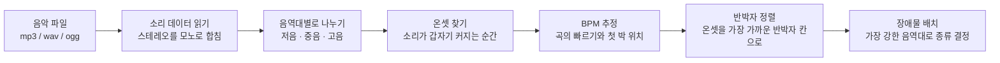
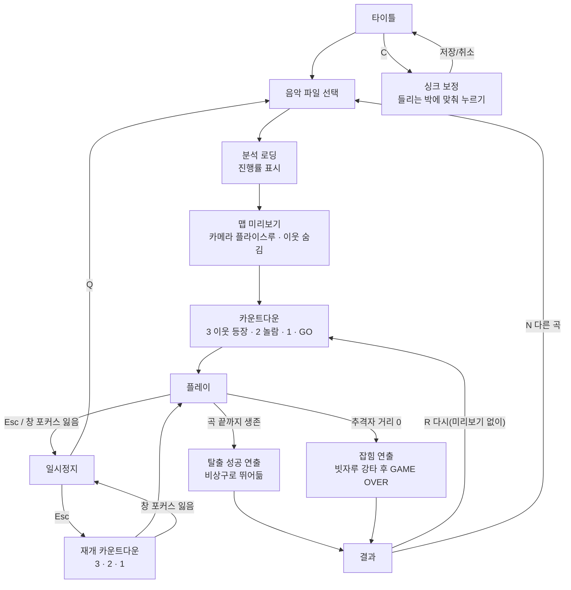

# 층간소음 런 (가제) 기획서

제1회 i-Keeper 바이브코딩 경진대회 출품작 기획서 (2026-11-15)

---

## 1. 개요

| 항목 | 내용 |
|---|---|
| 가제 | 층간소음 런 |
| 한 줄 소개 | 내가 고른 음악이 그대로 맵이 되고, 박자에 맞춰서만 움직여 층간소음 민원을 넣은 아랫집 이웃에게서 도망치는 횡스크롤 추격 탈출 리듬게임 |
| 장르 | 횡스크롤 추격 탈출 리듬게임 |
| 대회 주제 "게임"과의 연결 | 플레이어가 가진 음악 파일 한 곡이 곧 스테이지 하나가 된다. 같은 게임이라도 넣는 곡마다 다른 맵이 만들어져 반복 플레이할 이유가 생긴다. |
| 구동 환경 | Windows (제출 빌드 기준) |
| 개발 환경 | macOS에서 개발 후 Windows용으로 빌드 |
| 엔진 | Unity 6000.6.9f1, 2D (URP) |

---

## 2. 기획 의도

두 리듬게임의 핵심 재미를 섞었다.

- **비브리본(Vib-Ribbon)**: 음악 파일을 넣으면 그 곡으로 맵이 만들어지고, 장애물을 타이밍에 맞춰 통과한다.
- **크립트 오브 더 네크로댄서(Crypt of the NecroDancer)**: 박자에 맞춰서만 행동할 수 있다. 박자를 벗어난 입력은 페널티를 받는다.

두 요소를 섞으면 "아무 곡이나 넣어도 그 곡의 박자대로 몸이 움직이는" 경험이 된다. 여기에 뒤에서 쫓아오는 추격자를 붙여 긴장감을 더했다.

세계관에는 아이러니를 넣었다. 주인공은 층간소음 때문에 쫓기는 뮤지션인데, 앞을 막는 방화문은 어깨에 멘 붐박스 볼륨을 확 올려 그 음파로 날려버린다. 소음 때문에 도망치면서 소음으로 길을 여는 셈이다.

**흥미 포인트**
- 내 플레이리스트의 곡이 곧 스테이지라서 곡마다 맵이 다르다.
- 박자를 놓치면 이웃이 바로 등 뒤까지 다가오고, 콤보를 쌓으면 이웃을 뒤로 밀어낸다.
- 시작 전 카메라가 맵 끝까지 빠르게 훑어 "이번 곡은 이렇게 생겼다"를 먼저 보여준다.
- 잡히면 빗자루로 정수리를 맞는 연출이 나와서, 지더라도 웃을 수 있다.

---

## 3. 세계관·캐릭터·무대

### 세계관
작은 뮤지션이 집에서 음악을 틀다가 층간소음 민원을 받았다. 화가 난 아랫집 이웃이 빗자루를 들고 쫓아온다. 한 곡이 끝날 때까지 잡히지 않고 복도 끝 비상구까지 달아나면 탈출한다.

### 캐릭터

| 캐릭터 | 설명 |
|---|---|
| 주인공 (뮤지션) | 작고 귀여운 뮤지션. 헤드폰을 썼다. 키는 이웃의 약 1/3. 구멍이 숭숭 난 직사각형 스피커(붐박스)를 어깨에 메고 달린다. |
| 추격자 (아랫집 이웃) | 아랫집 이웃이 변한 화난 슬라임 괴물. 복도 천장에 닿을 만큼 크다(주인공의 약 3배). 촉수로 빗자루를 들고 화면 왼쪽에서 주인공을 쫓는다. |

### 무대
복도식 아파트를 옆에서 자른 단면. 주인공은 복도를 따라 오른쪽으로 달린다. 현관문, 호수 표지판, 복도 난간이 반복되어 배경을 이룬다. 복도 끝에는 초록색 비상구 문이 있다.

### 그래픽
픽셀아트(도트). 캐릭터, 이웃, 장애물, 복도 타일은 모두 코드 안의 문자 격자로 그려 런타임에 도트 스프라이트로 만든다(9절 참조).

---

## 4. 게임 규칙

### 4.1 장애물 3종

장애물은 곡의 해당 순간에 어느 음역대 소리가 가장 강한지에 따라 정해진다.

| 음역대 | 장애물 | 키 | 동작 |
|---|---|---|---|
| 저음 (20–250Hz) | 바닥에 놓인 택배 상자 | Space | 점프해서 넘는다 |
| 중음 (250–2000Hz) | 닫힌 현관 방화문 | → | 붐박스 볼륨을 확 올려 음파로 문을 날려버린다 |
| 고음 (2000–8000Hz) | 천장에 걸린 빨래 | ↓ | 슬라이드해서 밑으로 지나간다 |

### 4.2 박자 판정

모든 장애물은 반박자(1/2박) 간격의 격자 칸 위에 놓인다. 플레이어는 이 격자 칸에 맞춰서만 행동할 수 있다.

| 판정 | 조건 | 결과 |
|---|---|---|
| Perfect | 장애물 칸의 박자 시각 ±60ms 안에 맞는 키 입력 | 통과, 콤보 +1 |
| Good | 장애물 칸의 박자 시각 ±100ms 안에 맞는 키 입력(150 BPM보다 빠른 곡은 반박자 간격의 40%까지로 줄어듦) | 통과, 콤보 +1 |
| Miss | 장애물을 지날 때까지 맞는 입력이 없음, 또는 틀린 키 입력 | 콤보 0, 추격자가 한 번에 확 다가옴 |
| 헛박자 | 반박자 격자 칸의 판정 범위 밖에서 누른 입력 | 콤보 0, 추격자가 한 번에 확 다가옴 |

판정 범위는 장애물이 없는 빈 칸에도 똑같이 적용된다. 칸 사이에 헛박자 구간이 남도록 Good 범위는 반박자 간격의 40%를 넘지 않게 했다(앞뒤 칸의 범위를 합쳐도 간격의 80%). 처음에는 ±35/±70ms였는데, 직접 플레이해 보니 너무 박해서 ±60/±100ms로 넓혔다(T6). 기기마다 다른 소리 지연은 싱크 보정(E4)으로 맞춘다.

**타이밍바**(T6 사용자 결정, 처음 기획한 네크로댄서식 박 눈금 대신): 화면 하단 가운데에 판정 창을 색으로 칠한 바를 둔다. 가운데 초록 영역은 Perfect(±60ms), 그 바깥 노란 영역은 Good(±100ms, 빠른 곡은 더 좁음), 나머지 회색 영역은 판정 밖이다. 바 양 끝에서 타이밍 선 두 개가 일정한 속도로 가운데를 향해 다가와, 다음 장애물의 박자 시각에 가운데에서 합쳐진다(장애물 0.5초 전에 출발. 처음 1초에서 초록·노랑 영역이 너무 작아 보여 선을 2배 빠르게 바꿈). 앞 장애물을 지나면(통과·Miss 모두) 바가 다음 장애물로 초기화된다. 바 가운데 위의 붐박스 아이콘은 정박마다 들썩여 장애물이 없는 구간에도 박을 보여 준다. 판정 문구(PERFECT·GOOD·MISS·헛박자)는 주인공 머리 위에 잠깐 뜨고, 점수·콤보는 오른쪽 위에 표시한다.

### 4.3 추격자 규칙

- 추격자는 곡 진행률에 비례해 점점 빨라진다(시간 가속).
- Miss 또는 헛박자가 나면 콤보가 0이 되고 추격자가 한 번에 확 다가온다.
- 콤보가 10, 25, 50, … 에 도달할 때마다 추격자를 뒤로 밀어낸다.
- 주인공과 추격자 사이 거리가 0이 되면 잡힌다.
- 가속 정도, 다가오는 거리, 밀어내는 거리 같은 구체 수치는 초기값으로 시작해 플레이해 보며 조정한다(초기값은 구현명세.md 참조).

### 4.4 승리와 패배

**승리 (탈출 성공)**
곡이 끝날 때까지 잡히지 않으면 복도 끝의 초록색 비상구 문이 나타나고, 주인공이 그 문으로 뛰어들어 탈출한다. 이후 결과 화면으로 넘어간다.

**패배 (잡힘, Game Over)**
추격자와의 거리가 0이 되면 아래 순서로 연출이 진행된다.
1. 주인공이 달리던 속도를 점점 줄이고, 이웃이 따라와 바로 뒤에 선다. 음악은 같이 작아지며 멈춘다.
2. 주인공이 멈추고, 주인공과 이웃이 서로 마주본다.
3. 이웃이 한 걸음 다가서며 빗자루를 들어올렸다가 주인공의 정수리를 아주 세게 내리친다. 이때 화면이 잠깐 멈췄다가 흔들린다.
4. 화면에 "GAME OVER"가 표시된다.
5. 결과 화면으로 넘어간다.

---

## 5. 음악 → 맵 생성 원리

플레이를 시작하기 전에 곡 전체를 한 번에 분석해서 맵을 미리 만든다. 분석은 네 단계로 이루어진다.

### 5.1 온셋(onset) 찾기
온셋은 "새 소리가 시작되는 순간"이다. 드럼을 치거나 건반을 누르는 순간처럼 소리가 갑자기 커지는 지점을 말한다.

- 곡을 아주 짧은 조각(약 0.02초)으로 잘라 조각마다 어떤 높이의 소리가 얼마나 강한지 계산한다. 이 계산에 FFT를 쓴다.
- 소리를 저음, 중음, 고음 세 음역대로 나누고, 음역대마다 바로 앞 조각보다 소리가 얼마나 커졌는지 본다.
- 주변 약 0.5초의 평균보다 1.5배 이상 크게 튀는 지점을 온셋으로 본다. 조용한 곡이든 시끄러운 곡이든 그 곡 안에서 상대적으로 튀는 지점을 찾을 수 있다.

### 5.2 BPM 추정
BPM은 1분에 박이 몇 번 오는지를 나타내는 곡의 빠르기다.

- 온셋은 보통 일정한 간격으로 반복된다. 곡 전체의 온셋 세기 그래프를 조금씩 밀어 보며 원래 그래프와 가장 잘 겹치는 간격을 찾고, 이 간격을 박 간격으로 본다(자기상관).
- 대부분의 대중음악이 들어가는 70–180 BPM 범위 안에서 찾는다.
- 첫 박의 위치는 박 위치마다 온셋 세기를 더한 값이 가장 커지는 시작점으로 정한다.

### 5.3 반박자 정렬
실제 온셋은 박에서 조금씩 어긋나 있다. 그런데 이 게임은 "박자에만 행동"하는 규칙이라 장애물이 박에서 어긋나 있으면 규칙과 맞지 않는다.

- 그래서 모든 온셋을 가장 가까운 반박자(1/2박) 칸으로 옮긴다.
- 칸 하나에는 장애물을 최대 1개만 둔다. 여러 온셋이 같은 칸에 모이면 가장 강한 것 하나만 남긴다. 결과적으로 장애물 사이 최소 간격은 반박자가 된다.
- 곡 앞 3초에는 장애물을 두지 않아 플레이어가 준비할 시간을 준다.

### 5.4 장애물 종류 정하기
칸마다 어느 음역대 온셋이 가장 강했는지 보고 장애물을 정한다. 저음이면 택배 상자, 중음이면 방화문, 고음이면 빨래다. 그래서 베이스가 강한 구간에는 상자가, 하이햇이 강한 구간에는 빨래가 많이 나온다.

분석은 시간이 걸리므로 로딩 화면에 진행률을 표시한다.

---

## 6. 화면 흐름

| 화면 | 설명 |
|---|---|
| 타이틀 | 가제 로고와 시작 버튼. 현재 싱크 오프셋(ms)을 보여 주고, `C`로 싱크 보정을 열거나 `←`/`→`로 오프셋을 미세 조정할 수 있다고 안내한다(E4). |
| 음악 파일 선택 | 파일 선택창을 열어 mp3/wav/ogg 파일을 고른다. Windows와 macOS에서 같은 방식으로 동작한다. |
| 분석 로딩 | 곡을 불러와 온셋 분석, BPM 추정, 맵 생성을 하는 동안 진행률을 보여준다. |
| 맵 미리보기 | 시작 위치에 서 있는 캐릭터를 카메라가 비춘다. 화면 상단에 곡 이름과 BPM을 보여 준다. 이어서 카메라가 맵 끝까지 "쓔루루룩" 빠르게 한 번 훑고, 시작 위치로 돌아온 뒤 카운트다운으로 넘어간다. 이번 곡의 장애물 분포를 미리 보여주는 화면이다. 이 동안 이웃은 보이지 않는다. Space·Enter로 건너뛴다. |
| 카운트다운 | 캐릭터는 시작 위치에 선 채 화면 중앙에 "3", "2", "1"을 차례로 띄워 음악이 언제 시작되는지 알려준다. "3"에 이웃이 화면 왼쪽 밖에서 걸어 들어와 뒤에 서고, "2"에 캐릭터가 왼쪽을 보며 깜짝 놀라 작게 뛰고(머리 위 "!"), "1"에 다시 앞을 본다. 음악이 시작되는 순간 "GO"를 띄우고 둘 다 달리기 시작한다. 카운트다운 중에는 일시정지할 수 없다. |
| 플레이 | 음악이 재생되고 주인공이 복도를 달린다. 하단에 타이밍바, 오른쪽 위에 점수·콤보, 주인공 머리 위에 판정 문구, 왼쪽에 추격자가 보인다. Esc를 누르거나 게임 창이 포커스를 잃으면 일시정지한다. |
| 일시정지 | 음악과 화면이 멈추고 "일시정지 · Esc: 계속 · Q: 그만두기"가 뜬다. Esc를 누르면 멈춘 화면 그대로 3·2·1을 센 뒤(이 동안 Esc는 무시, 창이 포커스를 잃으면 다시 일시정지) 이어서 달린다. Q를 누르면 음악 파일 선택 화면으로 돌아간다. |
| 탈출 성공 연출 | 곡이 끝나면 복도 끝 초록색 비상구 문이 열리고 주인공이 뛰어든다. 문이 닫히면 "탈출 성공!"이 뜬다. |
| 잡힘 연출 | 속도 감소(이웃이 따라와 섬) → 정지 후 마주봄 → 한 걸음 다가서며 빗자루를 들어올림 → 정수리 강타(잠깐 정지, 화면 흔들림) → "GAME OVER". |
| 결과 | 마지막 장면 위에 반투명한 검은 패널을 덮어 탈출 성공/잡힘 여부, 곡 이름, 난이도, 점수, Perfect/Good/Miss 수, 최대 콤보를 보여준다. "R: 다시 · N: 다른 곡 · ←/→: 난이도". 다시(R)는 미리보기 없이 카운트다운부터 시작하고, 난이도를 바꿨으면 새 난이도로 다시 만든 맵으로 한다. |
| 싱크 보정 (E4) | 타이틀에서 `C`로 연다. 메트로놈 소리를 들으며 소리에 맞춰 Space를 누르면 소리 지연이 ms 단위로 측정되어 결과가 표시된다. 박을 보여 주는 화면 신호는 없고 소리만 듣고 누른다. Enter로 저장, R로 다시 측정, Esc로 저장하지 않고 취소한다. 측정이 고르지 않으면 이유가 표시되고 다시 해야 한다. 확장 항목(E4)이다. |

---

## 7. 조작키

| 키 | 동작 | 사용 상황 |
|---|---|---|
| Space 또는 ↑ | 점프 | 바닥의 택배 상자 (저음) |
| ↓ | 슬라이드 | 천장에 걸린 빨래 (고음) |
| → | 붐박스 음파 | 닫힌 현관 방화문 (중음) |
| Esc | 일시정지 / 일시정지에서 계속(3·2·1 뒤 재개) | 플레이 중 / 일시정지 |
| Q | 그만두고 파일 선택으로 | 일시정지 |
| C | 싱크 보정 열기 | 타이틀 |
| ← / → | 싱크 미세 조정 | 타이틀 |
| ← / → | 난이도 변경 | 파일 선택, 결과 |
| R / N | 다시(카운트다운부터) / 다른 곡 | 결과 |
| Space / Enter | 미리보기 건너뛰기 | 맵 미리보기 |

모든 행동 키는 반박자 격자 칸의 판정 범위 안에서 눌러야 한다. 범위 밖 입력은 헛박자로 처리된다.

---

## 8. 구현 범위

**이 목록이 구현률 평가 기준이다.** 필수 항목(F1~F9)을 먼저 완성하고, 남은 시간에 확장 항목(E1~E5)을 진행한다. 진행 순서는 핵심 1판(업로드 → 맵 생성 → 플레이 → 결과)을 먼저 완성하는 것이다. 같은 ID를 구현명세.md에서도 쓴다.

### 필수 (MVP)

- [ ] **F1** 파일 선택 업로드(mp3/wav/ogg, Win·Mac)
  - 완료 기준: Windows와 macOS에서 파일 선택창으로 mp3, wav, ogg 파일을 각각 골라 재생할 수 있다.
- [ ] **F2** 온셋 분석 + BPM 추정 + 반박자 정렬 맵 생성
  - 완료 기준: 업로드한 곡을 분석해 BPM을 구하고, 반박자 칸에 정렬된 장애물 목록을 만들어 맵에 배치한다(곡 앞 3초 비움, 칸당 최대 1개).
- [ ] **F3** 장애물 3종
  - 완료 기준: 택배 상자(Space 점프), 빨래(↓ 슬라이드), 방화문(→ 붐박스 음파)이 음역대에 따라 나오고 각각 맞는 키로 통과된다.
- [ ] **F4** 박자 판정(Perfect·Good·Miss·헛박자) + 타이밍바
  - 완료 기준: ±60ms Perfect, ±100ms Good(빠른 곡은 반박자의 40%까지), 그 외 Miss, 판정 범위 밖 입력은 헛박자로 판정되어 화면에 표시되고, 하단 타이밍바의 선 두 개가 다음 장애물 시각에 맞춰 가운데로 모인다.
- [ ] **F5** 시간 가속 + 콤보 밀어내기 추격자
  - 완료 기준: 추격자가 곡 진행에 따라 빨라지고, Miss·헛박자 시 다가오며, 콤보 10·25·50…에서 밀려나고, 거리 0이면 잡힘으로 처리된다.
- [ ] **F6** 카메라 플라이스루 미리보기
  - 완료 기준: 플레이 전 카메라가 시작 위치 → 맵 끝 → 시작 위치로 이동하고, 이어서 카운트다운(3·2·1·GO)이 끝나면 플레이가 시작된다.
- [ ] **F7** 타이틀~결과 전체 화면 흐름(탈출 성공·잡힘 연출 포함)
  - 완료 기준: 6절의 모든 화면이 순서대로 이어지고, 비상구 탈출 연출과 빗자루 강타 잡힘 연출 뒤 결과 화면에서 재도전/다른 곡으로 돌아갈 수 있다.
- [ ] **F8** 픽셀아트 그래픽
  - 완료 기준: 주인공, 이웃, 장애물 3종, 복도 배경이 도트 스프라이트로 표시된다.
- [ ] **F9** Windows 빌드 실행
  - 완료 기준: Windows 빌드 실행 파일로 F1~F8의 흐름을 처음부터 끝까지 한 판 플레이할 수 있다.

### 확장

- [ ] **E1** 조합 장애물
  - 완료 기준: 상자+빨래처럼 두 장애물이 한 칸에 함께 나오는 경우가 생성되고 통과 방법이 정해져 있다.
- [ ] **E2** 비트 반응 배경·화면 흔들림
  - 완료 기준: 배경이 박에 맞춰 반응하고, 지정된 순간(예: 잡힘 강타)에 화면이 흔들린다.
- [ ] **E3** 효과음
  - 완료 기준: 점프, 슬라이드, 붐박스 음파, 판정, 잡힘 같은 주요 동작에 효과음이 난다.
- [ ] **E4** 오디오 싱크 보정(캘리브레이션 + 미세 조정)
  - 완료 기준: 타이틀에서 싱크 보정을 열어 들리는 메트로놈에 맞춰 키를 누르면 오디오 지연이 ms 단위로 측정·저장되고, 판정 기준 시각과 비트 표시줄이 그만큼 보정된다. ←/→로 0.01초 단위 미세 조정도 할 수 있고 값은 재시작 후에도 유지된다.
- [ ] **E5** 최고 기록 저장
  - 완료 기준: 최고 기록이 게임을 껐다 켜도 유지되고 결과 화면에 표시된다.

---

## 9. 개발 환경·방식

| 항목 | 내용 |
|---|---|
| 엔진 | Unity 6000.6.9f1, 2D (URP) 템플릿 |
| 언어 | C# |
| 개발 OS / 제출 OS | macOS / Windows (Windows Build Support (Mono) 모듈 설치 완료) |
| 씬 구성 | 빈 씬 하나 + 부트스트랩 스크립트가 모든 오브젝트와 UI를 코드로 생성 (에디터 수작업 최소화) |
| 그래픽 | 캐릭터·이웃·장애물·복도 타일을 문자 격자(예: 16×16 `..##..`)로 코드에 정의하고 런타임에 도트 스프라이트(Texture2D, Point 필터)로 생성. 외부 무료(CC0) 에셋은 폰트·UI 정도만 사용 |
| 파일 선택 | StandaloneFileBrowser (gkngkc/UnityStandaloneFileBrowser, MIT 라이선스) 사용 예정 |
| mp3 디코딩 대안 | NLayer (MIT 라이선스) 사용 예정 |
| 작업 방식 (AI) | 코드 작성, Unity CLI와 Pipeline으로 컴파일 확인, 자동 플레이 테스트, 스크린샷 대조까지 AI가 직접 수행 |
| 작업 방식 (사람) | 음악과 판정의 싱크 체감, 재미 판단, 파일 선택창 동작, Windows PC 실행 확인, 최종 결정 |
| Unity 조작 도구 | 공식 Unity CLI + Unity Pipeline 패키지(com.unity.pipeline) 1.0.0. 프로젝트 경로는 맥 `~/Dev/beat-runner` |
| 에이전트 실행 환경 | 에이전트는 Docker 컨테이너 안에서 동작한다. C# 코드와 문서는 마운트된 프로젝트 폴더를 직접 수정하고, Editor 조작은 SSH로 맥의 `unity` 명령을 실행한다. |

상세 규칙은 프로젝트 루트의 AGENTS.md를 참조한다.

분석 알고리즘의 수치, 클래스 구성, 작업 순서 같은 상세 기술 내용은 **구현명세.md**에 정리했다.

---

## 10. 일정

대회 당일(2026-11-15) 10:00 기획 확정부터 23:59 마감까지의 대략적인 시간표다. 핵심 1판을 먼저 완성하고 남는 시간에 확장한다. 세부 작업 순서는 구현명세.md를 따른다.

| 시간 | 작업 | 관련 항목 |
|---|---|---|
| 10:00–11:00 | 기획 확정(기획서·구현명세), Unity 프로젝트 생성, Unity CLI 연결 확인, 테스트 기반, 파일 선택·재생 확인 (T1) | F1 |
| 11:00–11:30 | 조기 Windows 빌드 확인 (T2) | F1, F9 |
| 11:30–13:00 | 음악 분석(온셋·BPM·반박자 정렬), 테스트 음원 검증 (T3) | F2 |
| 13:00–13:45 | 도트 스프라이트 (T4) | F8, F3 |
| 13:45–15:00 | 레벨 생성, 주인공 동작, 카메라 추적 (T5) | F3 |
| 15:00–16:15 | 박자 판정, 비트 표시줄 (T6) | F4 |
| 16:15–17:00 | 추격자 (T7) | F5 |
| 17:00–18:45 | 화면 흐름(타이틀~결과), 미리보기, 탈출·잡힘 연출 (T8) | F6, F7 |
| 18:45–19:30 | 핵심 1판 Windows 빌드 확인 → 핵심 1판 완성 (T9) | F9 |
| 19:30–22:20 | 확장 항목, 밀리면 뒤에서부터 제외 (T10–T14) | E1~E5 |
| 22:20–22:30 | 밸런스 조정 | - |
| 22:30 | 기능 동결, 버그 수정만 | - |
| 22:30–23:30 | 최종 빌드, 기획서 PDF 변환, 소스코드 압축 (T15) | - |
| 23:30 | 메일 제출 목표 (kn7137@gmail.com) | - |
| 23:59 | 마감 | - |

---

## 11. 위험과 대응

| 위험 | 내용 | 대응 |
|---|---|---|
| StandaloneFileBrowser의 Unity 6 호환성 | 오래된 플러그인이라 Unity 6에서 동작하지 않을 수 있다. | 첫 작업으로 동작을 확인한다. 실패하면 persistentDataPath/Songs 폴더에 넣은 파일 목록에서 고르는 방식으로 바꾼다. |
| mp3 런타임 로딩 | UnityWebRequestMultimedia로 불러오는 mp3가 플랫폼·버전에 따라 실패할 수 있다. | 실패하면 C# mp3 디코더 NLayer로 PCM 디코딩한 뒤 AudioClip.Create로 만든다. |
| BPM 추정 실패, 템포가 바뀌는 곡 | 박이 뚜렷하지 않거나 중간에 빨라지는 곡은 BPM이 틀릴 수 있고, 장애물이 박과 어긋나게 된다. | 70–180 BPM 범위로 찾는 범위를 제한한다. 이 게임은 곡 전체를 한 BPM으로 보므로 박이 일정한 곡에서 가장 잘 동작하며, 테스트도 그런 곡으로 먼저 진행한다. |
| 오디오 지연 | 기기마다 소리가 늦게 들려 판정이 어긋나게 느껴질 수 있다. | 프레임 시간이 아니라 오디오 시계(AudioSettings.dspTime)를 기준으로 판정·화면을 동기화한다. 확장 E4의 싱크 보정(들리는 메트로놈에 맞춰 눌러 지연을 자동 측정)과 ←/→ 미세 조정으로 보정한다. |
| 시간 부족 | 게임 개발이 처음이라 예상보다 오래 걸릴 수 있다. | 핵심 1판(업로드 → 맵 생성 → 플레이 → 결과)을 먼저 완성한다. 확장은 그 뒤 남는 시간에만 한다. 22:30에 기능을 동결한다. |
| Unity CLI(Pipeline) 연결 실패 | Editor가 꺼져 있거나 창 포커스 대기, 컴파일 오류로 Safe Mode가 되면 AI의 CLI 검증이 막힌다. | Editor를 열어 두고 Unity 창을 한 번 클릭한다. 그 외 증상은 AGENTS.md의 문제 해결 표를 따른다. |

---

## 12. AI 활용 기록

평가 항목 ①~⑤별로 정리한다. 기획 단계 기록은 완료했다.

### ① 목표 전달 (원하는 동작·성공 기준)

**기획 단계 (완료)**
- 대회 정보를 AI에 전달했다: 주제 "게임", 구동환경 Windows, 평가 비중(소스코드 10% / 구현률 15% / AI 활용도 25% / 흥미도 50%), 제출 방식과 마감(2026-11-15 23:59).
- 원하는 게임을 직접 정의했다: 비브리본 + 네크로댄서를 섞은 횡스크롤 추격 탈출 리듬게임, 한 곡을 끝까지 잡히지 않고 들으면 탈출.
- 성공 기준을 정했다: 8절의 필수 F1~F9가 구현률 평가 기준이며, 핵심 1판(업로드 → 맵 생성 → 플레이 → 결과)을 먼저 완성한다.
- 이번 세션의 결과물은 문서(기획서, 구현명세)이고, 실제 개발은 다른 AI 세션·도구에서 진행한다고 범위를 정했다.

### ② 정보 제공 (입력 파일·오류·환경)

**기획 단계 (완료)**
- 개발 환경: Unity 6000.6.9f1 설치, 2D (URP) 템플릿 사용 예정, 프로젝트는 아직 생성 전.
- OS 조건: macOS에서 개발하고 Windows 빌드를 제출한다.
- 빌드 준비: Windows Build Support (Mono) 모듈 설치 완료.
- 남은 시간: 10시경 기획 확정, 24시 전 제출(약 14시간).
- 참가자 배경: 컴퓨터공학 2학년, 웹 풀스택 경험만 있음, 게임 개발은 처음.

### ③ 업무 위임 (AI 담당 범위·반환 지점)

**기획 단계 (완료)**
- AI 담당: C# 코드 작성(씬을 코드로 만드는 부트스트랩, 문자 격자 도트 스프라이트 포함), 컴파일 확인(`unity command script recompile` 후 콘솔 확인), 자동 플레이 테스트(Unity Test Framework PlayMode 테스트와 Input System 입력 시뮬레이션), 플레이 모드 실행과 화면별 스크린샷 대조. 명령 이름은 예시이며 실제로는 `unity command` 목록으로 확인한 뒤 쓴다.
- 사람 담당: Unity Editor를 열어 둔 상태 유지, 음악과 판정의 싱크 체감·재미·난이도 체감 확인, 네이티브 파일 선택창 동작 1회 확인, Windows PC에서 빌드 실행 확인, 최종 결정(무엇을 고칠지, 확장 진행 여부).
- 반환 지점: AI는 테스트 결과, 스크린샷, 콘솔 로그를 직접 읽고 요구사항과 대조해 보고한다. 사람은 체감 피드백(싱크, 재미)을 AI에게 전달한다.
- 문서: 기획서와 구현명세는 이번 기획 세션에서 AI가 작성했다. 구현명세는 어떤 AI 도구에 붙여넣어도 쓸 수 있도록 작성했다.
- 스킬화 여부 판단을 AI에 위임했고, AI는 일회성 프로젝트이고 다른 도구에서 작업한다는 이유로 불필요하다고 판단해 이식 가능한 구현명세 문서로 대체했다.

### ④ 결과 확인 (실제 결과 관찰·요구사항 대조)

**기획 단계 (완료)**
- AI가 요구사항 사이의 충돌 2건을 먼저 제기했다.
  1. **박자 vs 온셋**: "박자에만 행동" 규칙과 실제 온셋 위치가 박에서 어긋나는 문제 → 온셋을 반박자 격자로 정렬하기로 결정.
  2. **CC0 에셋 부재**: 세계관(복도식 아파트, 붐박스 멘 뮤지션, 잠옷 이웃(T4에서 슬라임 괴물로 변경))에 맞는 CC0 에셋이 거의 없다는 문제 → 코드 문자 격자 도트 그래픽으로 변경.
- 사용자는 4라운드 질의 동안 매 라운드 AI의 추천안을 검토하고, 원하는 방향과 다르면 직접 수정해 확정했다(⑤ 표 참조).

**개발 단계 (AI가 수행할 검증 방식)**
- 생성한 테스트 음원(알려진 BPM의 클릭·사인파 wav)으로 BPM 추정 오차와 반박자 정렬, 곡 앞 3초 비움, 음역대별 장애물 종류를 검증한다.
- 입력 시뮬레이션 PlayMode 테스트로 판정(Perfect/Good/Miss/헛박자), 추격자 거리 변화, 콤보 밀어내기, 잡힘·탈출 전환을 검증한다.
- 화면별(타이틀, 로딩, 미리보기, 플레이, 잡힘, 탈출, 결과) 스크린샷을 기획서와 대조한다.

### ⑤ 활용 결정 (확인 근거에 따른 결정·반영, 변경 이력)

**기획 단계 (완료): 사용자가 AI 추천안을 바꾼 결정**

| 항목 | AI 추천 | 최종 결정 | 근거 |
|---|---|---|---|
| 탈출 방식 | 단순 러너 | 추격 탈출 + 네크로댄서 + 비브리본 혼합 | 사용자가 원하는 재미(음악이 맵이 되고 박자에만 행동)를 직접 정의 |
| 업로드 | Windows 파일 선택창 | Windows·Mac 공통 파일 선택 방식 | 맥에서 개발하므로 Windows·Mac 공통 방식을 사용자가 요구 |
| 장애물 | 3종 | 3종 채택 + 조합 장애물을 확장 후보로 추가 | 사용자가 조합 장애물을 직접 추가 |
| 추격자 | 거리 게이지 | 시간 가속 + 콤보로 버티기 | 사용자가 추격 방식을 직접 지정 |
| 화면 흐름 | AI 기본안 | 맵 미리보기 추가, 카메라 플라이스루 방식 | 사용자가 미리보기 화면과 카메라 동작을 직접 설계 |
| 세계관 | 음악을 삼키는 정적 괴물 | 층간소음 민원으로부터 도망치는 뮤지션 | 사용자가 세계관을 직접 제시 |
| 무대·캐릭터 | AI 기본안 | 복도식 아파트 단면, 붐박스 멘 작은 캐릭터 | 사용자가 직접 지정 |
| 잡힘 연출 | 빗자루로 붐박스 끄기 | 서로 마주보다 빗자루로 정수리 강타 후 Game Over, 캐릭터 키 = 이웃의 절반 | 사용자가 연출 순서와 체격 차이를 직접 지정 |
| 추격자 외형 | 잠옷 차림 이웃(주인공의 2배) | 복도 높이(46px)의 화난 슬라임 괴물 + 빗자루, 빗자루는 등 뒤로 젖혔다 앞으로 내리침 | 사용자가 T4에서 직접 지정 |
| 빗자루 색 | 피부와 같은 색(#ffcd75) | 짚 색(#e0a040) | AI가 피부와 구별되지 않는 가독성 문제를 제기해 사용자 승인 |
| 그래픽 | CC0 에셋 (사용자 첫 선택) | 코드 문자 격자 도트 | AI가 세계관에 맞는 CC0 에셋이 거의 없다는 충돌을 제기 |
| 판정 정렬 | (충돌 제기) | 반박자 격자 정렬 | AI가 "박자에만 행동 vs 온셋 위치 불일치" 충돌을 제기 |
| 스킬화 | (사용자가 판단 위임) | 스킬화하지 않고 이식 가능한 구현명세 문서로 대체 | 일회성 프로젝트이고 다른 도구에서 개발 |
| 비트 표시줄 | 네크로댄서식 박 눈금(정박·반박 눈금이 중앙으로 다가옴) | 판정 창을 색으로 칠한 타이밍바(초록 Perfect·노랑 Good·회색 밖), 양 끝 선이 다음 장애물 시각에 합쳐지고 장애물을 지나면 초기화. 붐박스 아이콘 박동은 유지 | 사용자가 T6에서 직접 설계 |
| 판정 반응 | 판정 문구는 타이밍바 위, 틀린 키 Miss는 맞음 프레임만 | 판정 문구는 주인공 머리 위, 틀린 키 Miss는 맞음 프레임만(추천 채택) | 사용자가 T6에서 결정 |
| 판정 범위 | Perfect ±35ms / Good ±70ms 고정 | Perfect ±60ms / Good ±100ms, 빠른 곡은 Good을 반박자의 40%로 제한 | 사용자가 T6에서 직접 플레이해 보고 "너무 박하다"고 판단. AI가 플레이 로그(Δ 평균 −12ms, 표준편차 약 59ms, 헛박자 14건 중 11건이 ±100ms 안)를 근거로 싱크 문제가 아니라 범위 문제임을 확인 |
| 작업 방식 | AI 코드 작성 + 사용자가 Unity에서 실행·보고 | Unity CLI(Pipeline)로 AI가 컴파일·자동 플레이 테스트·스크린샷 확인까지 직접 수행, 사용자는 싱크 체감·재미·Windows 실행 확인 | 사용자가 Unity CLI 환경을 구축하고 AI 직접 검증을 요청 |
| 이웃 등장과 놀람 | 미리보기 때부터 이웃이 화면에 서 있음 | 미리보기 동안 이웃을 숨기고, 카운트다운 "3"에 화면 밖에서 걸어 들어오고 "2"에 주인공이 놀라 점프, "1"에 다시 앞을 봄 | 사용자가 T8 설계에서 직접 지정 |
| 카운트다운 중 주인공 | 곡 시작 전 구간을 달려오며 카운트 | 시작 위치(x=0)에 서서 카운트, 곡이 시작될 때 달리기 시작 | 사용자가 T8 설계에서 직접 지정 |
| 마주봄 간격 | 감속·마주봄·강타 모두 24px 간격 | 감속·마주봄은 28px로 서고, 들어올림 때 24px로 한 걸음 다가섬(28 → 24) | 24px에서는 대기 프레임 몸이 약 3px 겹쳐 사용자가 T8에서 직접 지정 |
| 일시정지 재개 | 곧바로 재개 | Esc로 재개하면 멈춘 화면 그대로 3·2·1을 센 뒤 재개 | 사용자가 T8 설계에서 직접 지정 |
| 결과 화면 | 마지막 장면과 분리된 결과 화면 | 마지막 장면 위에 반투명 검은 패널(불투명도 0.65)로 덮음 | 사용자가 T8 설계에서 직접 지정 |
| 다시 하기(R) | 미리보기부터 다시 | 미리보기 없이 카운트다운부터 다시 | 사용자가 T8 설계에서 직접 지정 |
| 점프 키 | Space만 | Space와 ↑ 둘 다 점프 | 사용자가 T8 플레이 뒤 요청(방향키만으로도 플레이) |

---

## 13. 제출물

제출처: kn7137@gmail.com (대회 기간 내 접수분만 인정)

| 제출물 | 내용 | 필수 여부 |
|---|---|---|
| 기획서 PDF | 이 문서(docs/기획서.md)를 PDF로 변환 | 필수 |
| 소스코드 압축 파일 | Unity 프로젝트에서 `Assets/`, `Packages/`, `ProjectSettings/`, `docs/` 포함. `Library/`, `Temp/`, `Logs/`, `obj/`, `Build/` 제외 | 필수 |
| Windows 빌드 | 실행 파일과 데이터 폴더를 압축 | 선택 |
